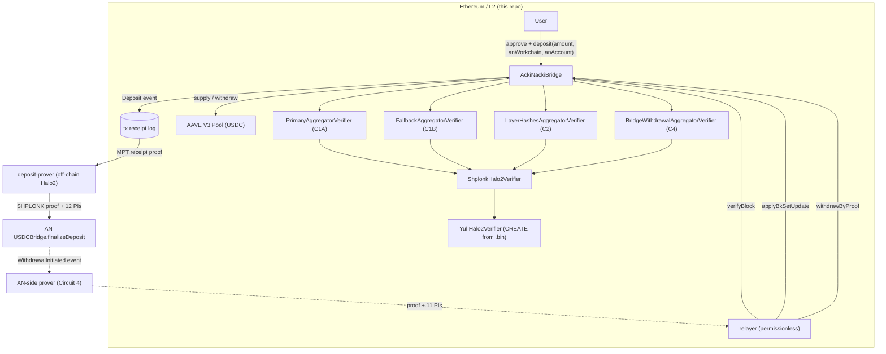

# Ethereum Contracts — Implementation Specification

**Status:** as-implemented (descriptive, not aspirational).
**Derived from:** the Solidity sources under `contracts/ethereum/` at commit `4021c68`
(`Merge branch 'main' into pruvendo/eth-39-withdraw`), `2026-09-25`. All `file:line`
citations below are re-anchored to that commit — the two-line-number-bases split that
previous revisions of this document carried is gone. When editing the spec, either
re-run the re-anchoring pass or leave a fresh dated note here calling out the drift.

> **Drift note, 2026-10-12 (ETH-28).** The AAVE behaviour in §6 (payout top-up), §10 and §11
> describes the code after `writeOffUnbackedPrincipal` landed; the line numbers in those rows
> are still those of `4021c68`. `writeOffUnbackedPrincipal`, `_backedPrincipal`,
> `AaveSupplyFailed`, `NothingToWriteOff`, `HarvestWouldBreakSolvency` and
> `UnbackedPrincipalWrittenOff` did not exist at that commit and carry no line number.
>
> **Drift note, 2026-10-14** (after merging `main`): `src/AckiNackiBridge.sol` has grown since
> `4021c68` — the pause switch, then the bundle-aware `applyBkSetUpdate` rule, `bundleStride` and
> `genesisLastBkSetUpdateSeqNo` — and no re-anchoring pass has been run since. Citations below that
> were not re-checked point too early: by about 30 lines around `HistoryWindow` (`:259` → `:289`)
> and by about 100–160 from `deposit` on (`:672` → `:772`, `applyBkSetUpdate` `:898` → `:1011`,
> `transferOwnership` `:1565` → `:1720`). Checked against the current source: §4.1's storage table
> (slots with `forge inspect`), the `whenNotPaused` and `pause()` / `unpause()` citations (`:536`,
> `:1685`, `:1692`), §4.2's `bundleStride` row (`:234`), §4's `InvalidBundleStride` (`:714`), and
> §7.3's description of the rotation gate.

**Method:** written by reading the contract sources only. No pre-existing prose was used as input;
where the older documentation and the code disagree, the divergences are itemised in §16.

> **Path convention.** Every behavioural claim below cites `file:line`. Bare paths beginning
> `src/`, `test/`, `script/` or `verifiers/` are relative to **`contracts/ethereum/`** — this
> document was written next to those sources and moved to `docs/` on 2026-08-18 without rewriting
> its ~400 citations. So `:578` and `src/AckiNackiBridge.sol:578` both mean
> `contracts/ethereum/src/AckiNackiBridge.sol:578`. Any other path is relative to the repository
> root.
>
> Where the code and a comment inside the code disagree, the code wins and the divergence is
> called out.

---

## 1. Scope

This document specifies the complete Ethereum-side contract system: the bridge contract, the ZK
verifier stack it calls, the block-header oracle interface, the deploy scripts, and the on-chain
ABI surface that off-chain components depend on.

Out of scope (referenced only where the EVM side binds to them): the Acki Nacki (AN) TVM contracts,
the Halo2 circuits themselves, and the Rust prover/relayer crates.

### 1.1 File inventory

| Path | Lines | Role |
|---|---:|---|
| `src/AckiNackiBridge.sol` | 1403 | **The bridge.** Custody, deposits, AN-state commitment, withdrawal payout, AAVE yield. |
| `src/IPrimaryVerifier.sol` | 36 | Circuit 1A (primary attestation) verifier interface — 4 PIs. |
| `src/IFallbackVerifier.sol` | 33 | Circuit 1B (fallback attestation) verifier interface — 4 PIs. |
| `src/ILayerHashesMovementVerifier.sol` | 45 | Circuit 2 (layer-hash movement) interface — 14 PIs. |
| `src/IBridgeWithdrawalVerifier.sol` | 77 | Circuit 4 (bridge withdrawal event) interface — 11 PIs. |
| `src/ShplonkAggregatorVerifierBase.sol` | 32 | Shared adapter base: instance reader + SHPLONK dispatch. |
| `src/PrimaryAggregatorVerifier.sol` | 30 | 1A adapter (instances[12..15] ↔ args). |
| `src/FallbackAggregatorVerifier.sol` | 30 | 1B adapter (instances[12..15] ↔ args). |
| `src/LayerHashesAggregatorVerifier.sol` | 34 | Circuit-2 adapter (instances[12..25] ↔ args). |
| `src/BridgeWithdrawalAggregatorVerifier.sol` | 44 | Circuit-4 adapter (instances[12..=22] ↔ `pub`, eleven slots). |
| `src/ShplonkHalo2Verifier.sol` | 31 | `staticcall` shim onto CREATE-deployed Yul verifier bytecode. |
| `src/IShplonkHalo2Verifier.sol` | 7 | `verify(bytes) → bool`. |
| `src/IBlockHeaderOracle.sol` | 27 | Block-hash oracle interface. |
| `src/AxiomBlockHeaderOracle.sol` | 186 | Axiom V2 Core–backed oracle implementation. |
| `src/MockBlockHeaderOracle.sol` | 76 | Test/E2E oracle (owner-settable hashes + `blockhash()` fallback). |
| `src/IAavePool.sol`, `src/IERC20.sol` | 47 / 12 | Minimal external interfaces. |
| `src/cctp/CctpEndpoint.sol` | 191 | CCTP burn on a source chain (`depositToHub`) and the return leg (`bridgeOut`). One deployment, many tokens. |
| `src/cctp/CctpHubReceiver.sol` | 231 | Hub side of a CCTP burn: attestation, mint, `AckiNackiBridge.deposit`. One deployment per bridge/token. |
| `src/cctp/CctpV2Message.sol`, `src/cctp/AnDestinationHook.sol` | 148 / 43 | Circle V2 message layout and the versioned Acki Nacki hook. |
| `src/cctp/CctpDomains.sol` | 22 | Circle domain ids and finality thresholds. |
| `src/cctp/ITokenMessengerV2.sol`, `src/cctp/IMessageTransmitterV2.sol`, `src/cctp/IDepositBridge.sol` | 33 / 12 / 14 | Circle and bridge interfaces the two contracts call. |
| `src/testnet/SepoliaAaveUsdcShim.sol` | 104 | Testnet only. Stands where a hub receiver expects the bridge; swaps Circle USDC for the Aave faucet USDC an AAVE-enabled Sepolia bridge custodies. See §6.2. |
| `src/testnet/TestnetAavePool.sol`, `src/testnet/IAaveTestnetFaucet.sol` | 142 / 8 | Testnet only. The slice of the Aave V3 Pool the bridge calls, with its own aToken and an owner `accrue` for interest. See §6.2. |
| `verifiers/*.bin` | — | Production SHPLONK Yul **creation** bytecode (4 circuits). |
| `verifiers/*_calldata.bin` | — | Reference `instances ‖ proof` calldata fixtures. |
| `verifiers/{Primary,Fallback,LayerHashes}AggregatorVerifier.sol` | 82–92 KB | Generated `Halo2Verifier` Yul-in-Solidity sources (reference; the `.bin` is what deploys). |
| `script/*.s.sol`, `script/ShplonkDeployLib.sol` | 61–349 | Deployment. See §8. |
| `test/**` | ~3.4 k | Foundry tests + mocks + fixtures. See §9. |

Nothing under `contracts/ethereum/` is upgradeable: there is no proxy, no admin-upgrade path, and
every verifier binding is `immutable`. Changing a verifier or an identity constant means deploying a
new bridge.

---

## 2. System overview



Two independent directions:

* **ETH → AN (deposit).** Purely an event emission on this side (`AckiNackiBridge.deposit`,
  `src/AckiNackiBridge.sol:672`). No Ethereum-side proof verification is involved; the event's log
  is proven off-chain and consumed natively by the AN `USDCBridge`. The bridge keeps custody of the
  USDC.
* **AN → ETH (state attestation + payout).** `verifyBlock` (`:739`) advances a rolling commitment to
  AN state from two cross-bound ZK proofs; `withdrawByProof` (`:1295`) pays out USDC against a
  Circuit-4 proof anchored into state that `verifyBlock` already recorded. `applyBkSetUpdate`
  (`:898`) rotates the AN validator-set (BK-set) commitment.

There is **no** `withdraw(depositId, …)` refund path; the withdrawal surface consists solely of
`withdrawByProof`, described in §7.2.

---

## 3. `AckiNackiBridge` — constants

| Constant | Value | Line | Meaning |
|---|---|---:|---|
| `USDC_UNIT` | `10**6` | 50 | USDC has 6 decimals. Declared, not used internally. |
| `MAX_DEPOSIT_AMOUNT` | `type(uint64).max` | 55 | Per-tx deposit cap. Chosen so the amount fits the AN `USDCBridge` mint path (`fr[2]` as `uint64`), **not** as a TVL limit. |
| `BPS_DENOMINATOR` | `10_000` | 58 | Basis-point denominator. |
| `MAX_LIQUID_RESERVE_BPS` | `5_000` | 61 | Liquid reserve is capped at 50 %. |
| `MAX_LAYER_HASHES` | `10` | 65 | Layer slots per AN block (mirrors Circuit 2 `MAX_LAYERS`). |
| `HISTORY_PROOF_WINDOW` | `128` | 80 | Rolling-window depth **per layer**. |
| `BN254_R` | `0x30644e72…f0000001` | 84 | BN254 scalar field order; used only by `applyBkSetUpdate` to reduce a SHA-256 root into `Fr`. |
| `RECIPIENT_HALF_MASK` | `(1 << 80) - 1` | 1253 | 10-byte half of a split-α recipient address. |

`enum FinalizationType { Primary, Fallback }` (`:90`) mirrors the AN attestation circuit's binary
split (≥ 2/3 quorum vs > 1/2 split).

---

## 4. Storage

### 4.1 Mutable state (declaration order)

Slots below are the output of `forge inspect AckiNackiBridge storage-layout`; re-run it before
relying on them for a storage-level migration.

| Slot | Offset | Var | Type | Line | Written by |
|---:|---:|---|---|---:|---|
| 0 | 0 | `depositCounter` | `uint256` | 100 | `deposit` |
| 1 | 0 | `treasuryBalance` | `uint256` | 104 | `deposit` (+), `withdrawByProof` (−) |
| 2 | 0 | `blockHeaderOracle` | `IBlockHeaderOracle` | 110 | constructor only |
| 2 | 20 | `aaveEnabled` | `bool` | 126 | constructor, `setAaveEnabled`, `emergencyWithdrawAll` |
| 3 | 0 | `suppliedPrincipal` | `uint256` | 129 | `supplyToAave`, `_pullFromAave`, `emergencyWithdrawAll`, `writeOffUnbackedPrincipal` |
| 4 | 0 | `liquidReserveBps` | `uint256` | 134 | constructor (`1_000`), `setLiquidReserveBps` |
| 5 | 0 | `owner` | `address` | 137 | constructor, `acceptOwnership` |
| 6 | 0 | `pendingOwner` | `address` | 140 | `transferOwnership`, `acceptOwnership` |
| 7 | 0 | `yieldRecipient` | `address` | 143 | constructor, `setYieldRecipient`, `acceptOwnership` (when it was the previous owner) |
| 7 | 20 | `paused` | `bool` | 149 | `pause`, `unpause` |
| 8 | 0 | `_reentrancyStatus` | `uint256` | 154 | `nonReentrant` |
| 9 | 0 | `storedBkSetCommitment` | `uint256` | 182 | constructor, `applyBkSetUpdate` |
| 10 | 0 | `storedLastBkSetUpdateSeqNo` | `uint64` | 189 | `applyBkSetUpdate` |
| 10 | 8 | `storedLastSeenBlockSeqNo` | `uint64` | 193 | constructor, `verifyBlock` |
| 11 | 0 | `storedPrevBkSetCommitment` | `uint256` | 200 | `applyBkSetUpdate` |
| 12 | — | `_nullifiers` | `mapping(bytes32 ⇒ bool)` | 284 | `withdrawByProof` |
| 13 | — | `_layerWindows` | `mapping(uint8 ⇒ HistoryWindow)` | 303 | `_appendLayer` |

`blockHeaderOracle` is **write-only in practice**: it is set in the constructor (`:588`) and never
read anywhere in `src/`. It is retained for a future burn-proof flow (`:106-110`).

### 4.2 Immutables (no storage)

| Var | Type | Line | Notes |
|---|---|---:|---|
| `usdc` | `IERC20` | 117 | Deposit/payout token. Must be non-zero. |
| `aavePool`, `aUSDC` | `IAavePool`, `IERC20` | 120, 123 | Both zero ⇒ AAVE disabled; exactly one zero ⇒ constructor reverts. |
| `primaryVerifier`, `fallbackVerifier`, `layerHashesVerifier` | interfaces | 159, 165, 171 | Any zero ⇒ `verifyBlock` disabled. |
| `bundleStride` | `uint64` | 234 | Prover bundle width in block seq-nos (L1 = 1024, L2 = 16384); divisor in the `applyBkSetUpdate` boundary invariant. Mandatory when the verifier triple is wired; may be zero when `verifyBlock` is disabled. L1↔L2 switch requires a redeploy. |
| `storedPrevMaxLevelLayerHash` | `uint256` | 204 | **Genesis seed only** since storage v2.0 (2026-08-04). Read exclusively by `_expectedPrevAnchor` when no layer window is populated (`:1118`). |
| `bridgeWithdrawalVerifier` | `IBridgeWithdrawalVerifier` | 218 | Zero ⇒ `withdrawByProof` disabled. |
| `bridgeWithdrawalDappFr`, `bridgeWithdrawalAccFr` | `uint256` | 226, 229 | AN-side bridge identity the C4 proof must bind to. |
| `bridgeWithdrawalAltDstChainId`, `bridgeWithdrawalAltDstHostChainId`, `bridgeWithdrawalAltTokenId` | `uint256` | 232, 236, 239 | Shellnet/testnet aliases (§7.2). |

### 4.3 `HistoryWindow` (`:259-271`)

```solidity
struct HistoryWindow {
    uint256[128] data;      // layer-hash values, circular
    uint64[128]  heights;   // ABI-stable, always zero; seq_nos are in LayerAnchorAppended
    uint16 dataLen;         // saturating fill level, capped at 128
    uint16 writeCursor;     // next write index
    uint64 lastHeight;      // height of the most recent append
}
```

One window per layer `L ∈ [1, 10]`, in `_layerWindows`. `heights` is ABI-stable but
**not written** on `verifyBlock` — `lastHeight` is the monotonicity guard, and
per-slot seq_nos are in `LayerAnchorAppended`. The relayer paints `heights` from
those logs on resurrect. This is the **authoritative** AN-state store;
the flat `storedNumLayers` / `storedLayerHashes[10]` cache was removed in storage v2.0 along with the
per-block `storedPrevMaxLevelLayerHash` SSTORE (`:846-852`, ≈ 32 k gas/call saved).

---

## 5. Constructor and deployment configuration

```solidity
constructor(
    address _blockHeaderOracle,   // required, non-zero, never read afterwards
    address _usdc,                // required, non-zero
    address _aavePool,            // 0 ⇒ AAVE disabled
    address _aUSDC,               // 0 ⇒ AAVE disabled
    VerifyBlockConfig memory _vb,
    BridgeWithdrawConfig memory _bw
)                                                        // :572-644
```

`VerifyBlockConfig` (`:495-516`): `primaryVerifier`, `fallbackVerifier`, `layerHashesVerifier`,
`genesisBkSetCommitment`, `genesisPrevMaxLevelLayerHash`, `genesisLastSeenBlockSeqNo`,
`bundleStride`. `bundleStride` is the prover's bundle width in block seq-nos (W·P = 1024 for L1,
W² = 16384 for L2) and is immutable after construction; `applyBkSetUpdate` divides by it to detect
whether a second rotation would cross an unverified bundle boundary. When the verifier triple is
wired, `bundleStride != 0` is required (else `InvalidBundleStride`, `:714`); when the triple is
unwired (`verifyBlock` disabled) the field is unused and may be zero.

`BridgeWithdrawConfig` (`:525-550`): `bridgeWithdrawalVerifier`, `dappFr`, `accFr`, `altDstChainId`,
`altDstHostChainId`, `altTokenId`.

Validation performed (and *not* performed):

| Check | Line | Behaviour |
|---|---:|---|
| `_blockHeaderOracle != 0` | 580 | else `InvalidOracle` |
| `_usdc != 0` | 581 | else `InvalidUsdc` |
| AAVE pair is all-or-nothing | 584-586 | else `InvalidAaveAddress` |
| C4 verifier set ⇒ `accFr != 0` | 600-608 | else `InvalidBridgeWithdrawalIdentity`. **`dappFr == 0` is legal** (shellnet zero-`dapp_id` deployments), despite the NatSpec at `:568-569` saying both must be non-zero. Test `test_constructor_withdrawEnabledWithZeroDappFr_succeeds` pins the code behaviour. |
| C4 verifier set ⇒ `dappFr`, `accFr`, `altTokenId` canonical Fr | | else `FieldElementOutOfRange`. Zero remains legal for `dappFr` and `altTokenId`. |
| `genesisBkSetCommitment != 0` when verifiers wired | — | **Not enforced on-chain**; only the deploy script enforces it (`script/DeployRealBridge.s.sol:141`). |
| verifier triple is all-or-nothing | — | **Not enforced at construction**; a partially wired triple simply makes `verifyBlock` revert `VerifyBlockDisabled` at call time (`:750-756`). |

Post-conditions: `owner = yieldRecipient = msg.sender`, `aaveEnabled = (both AAVE addresses set)`,
`liquidReserveBps = 1_000` (10 %), reentrancy guard armed, `OwnershipTransferred(0, msg.sender)`
emitted (`:637-643`).

---

## 6. ETH → AN: deposits

```solidity
function deposit(uint256 amount, int8 anWorkchain, bytes32 anAccount) external nonReentrant whenNotPaused  // :672
```

`whenNotPaused`: reverts `BridgePaused()` while `paused` is true (`:536`).

Sequence (`:673-681`):

1. `amount != 0` else `InvalidAmount`.
2. `amount <= MAX_DEPOSIT_AMOUNT` else `DepositTooLarge`.
3. `anAccount != 0` else `InvalidAnAccount` — an EVM address is not a valid AN recipient, so the
   256-bit TVM destination is supplied explicitly.
4. `usdc.transferFrom(msg.sender, address(this), amount)`; a `false` return ⇒ `TransferFromFailed`.
5. `depositId = depositCounter++`, `treasuryBalance += amount`.
6. `emit Deposit(depositId, msg.sender, amount, anWorkchain, anAccount, block.timestamp)`.

Notes that matter downstream:

* Funds stay as plain USDC in the contract; batching into AAVE is a separate owner action (§10).
* `amount` is credited as requested, not as the observed balance delta — a fee-on-transfer token
  would over-credit `treasuryBalance`. USDC is not fee-on-transfer.
* The `Deposit` **event layout is a hard cross-repo ABI**: the off-chain prover parses
  `topics[1] = depositId`, `topics[2] = sender`, and reads `data` word-wise, including
  `anWorkchain` at `data[63]` (`deposit-prover/src/ethereum_fetcher.rs:128`). Reordering or
  retyping event fields breaks proof generation, not just indexing.
* The proof's 12 public inputs are `deposit_id, sender, amount, contract_address, chain_id,
  dapp_id_{high,low}, an_account_{high,low}, block_hash_{high,low}, promise_commit`
  (`crates/deposit-relayer-daemon/src/types.rs:101-115`). `anWorkchain` is emitted by the contract
  but is **not** one of them — `dappId` (a config-supplied tag) replaced it.
* Deposits are provable from an allowlisted set of chains: Ethereum mainnet (1), OP Mainnet (10),
  World Chain (480), Mantle (5000), Base (8453), Arbitrum One (42161), Blast (81457), Sepolia
  (11155111) (`crates/deposit-chain-ids/src/lib.rs:33-42`). The contract itself is chain-agnostic;
  the constraint lives in the prover/relayer allowlist and the AN-side `(chainId → bridge Fr)`
  allowlist. The circuit takes `chain_id` as a public input and does not fix it, so the list
  changes without a new verification key.
* A CCTP deposit (Arbitrum USDC and the other rows in §6.1) does **not** use the source chain's
  row. The proof is of the hub `Deposit`, so the chain id inside it is the hub's (1 on mainnet).

### 6.1 Remote USDC via CCTP

`CctpEndpoint` and `CctpHubReceiver` (`src/cctp/`) move an issuer token onto the
hub bridge. Circle's `TokenMessengerV2` burns on the source and mints on the
hub; it does not call the recipient. `CctpHubReceiver` is the only
`destinationCaller` on the burn message and credits in two transactions:

1. `receiveBurn(message, attestation)` — permissionless. Checks the source row,
   mints through `MessageTransmitterV2.receiveMessage`, and parks
   `amount - feeExecuted` (from the attested burn body, `src/cctp/CctpV2Message.sol`)
   under `messageKey(sourceDomain, nonce) = keccak256(abi.encode(sourceDomain, nonce))`.
   Emits `RemoteDepositReceived`. `pending(key)` and `totalPending` expose the parked amounts.
2. `forward(key)` — a `setForwarder`'d address calls
   `AckiNackiBridge.deposit` for the parked amount. No event of its own.

The split protects provability. The deposit circuit takes only a type 1 or type 2 enclosing
transaction whose receipt fits its keccak budget (`deposit-prover/src/circuit_v2.rs`). The Circle
attestation is public once Iris signs it, so a single permissionless mint-and-deposit call could
be sent by anyone as a legacy (type 0) or EIP-7702 transaction, leaving a `Deposit` no one can
prove. Minting only parks the funds, so `receiveBurn` stays open; the contract cannot check the
transaction type, so `forward` is limited to forwarders. Nothing on chain
enforces the type: a wrong type leaves an unprovable `Deposit` with the funds
in the bridge. `forward` is 36 bytes
of calldata, and with the standing maximum allowance the constructor grants the bridge its
receipt is `Transfer` + `Deposit`.

The hook is `abi.encode(uint8(1), int8 anWorkchain, bytes32 anAccount, address depositor)`
(`src/cctp/AnDestinationHook.sol`). `anAccount` becomes the `Deposit` event's
account. `depositor` is only in `RemoteDepositReceived`. The event's `sender`
is the receiver, because that is who calls `deposit`.

Registries, not hard-coded chains or tokens:

* `CctpEndpoint.setHub(token, destinationDomain, hubReceiver, enabled)` — which
  hub a local token burns toward. One endpoint per chain, many tokens.
* `CctpEndpoint.setEgressDomain(domain, allowed)` — `bridgeOut` destinations.
  No hook; the mint recipient is the argument.
* `CctpHubReceiver.setSource(domain, chainId, adapter, remoteToken, remoteTokenMessenger, enabled)` —
  which remote adapter and TokenMessenger may originate burns of which remote token.
  `receiveBurn` also requires the outer CCTP `recipient` to be the local
  `TokenMessengerV2`. One receiver per hub bridge, so one token. A second token
  is a second bridge and a second receiver. Do not pass a non-USDC hub bridge
  to `setTrustedL1Bridge`: `confirmDeposit` always mints USDC ECC.
* `CctpHubReceiver.setForwarder(account, allowed)` — who may call `forward`.

`CctpDomains` records Circle's domain ids (Arbitrum = 3, Ethereum = 0, Base = 6,
OP = 2, Polygon = 7) and the finality thresholds 1000 (fast) and 2000
(finalized). `script/DeployCctp.s.sol` deploys one of the two contracts;
`setHub` / `setSource` / `setEgressDomain` / `setForwarder` are separate owner calls. Both
contracts can `rescue` tokens sent to them outside these flows; the receiver's `rescue` cannot
take the bridge token below `totalPending` (`PendingFunds`).

`deposit-relayer cctp-forward` (one burn) and `deposit-relayer cctp-daemon`
(every `HubDeposit` on the source endpoint) read Circle Iris and call
`receiveBurn`, then `forward` as an EIP-1559 transaction with no access list. They read
`pending(key)` first, so a restart neither re-mints nor double-forwards, and they log an error
if a `forward` receipt is not type 1 or 2 or has more than 20 logs. Their key must be a
forwarder.
They do not prove the deposit and they do not call Acki
Nacki. Iris is queried with the source domain and the burn transaction hash,
not with `HubDeposit.destinationDomain` (that field is the hub's domain).

`deposit-relayer daemon` against the hub bridge then proves the `forward` transaction's
`Deposit`. `scripts/cctp_usdc.sh` wires the contracts (`set-forwarder` included) and
`print-keepers` prints both processes.

### 6.2 AAVE on Sepolia (testnet only)

On Sepolia, CCTP mints Circle USDC (`0x1c7D…7238`), and the Aave V3 market lists only the Aave
faucet's own USDC (`0x94a9…E4C8`). A bridge with AAVE enabled has to custody the faucet token, so a
hub receiver cannot deposit into it directly. Two testnet contracts close the gap; neither belongs
on mainnet, where the hub bridge custodies Circle USDC and supplies it to the real market.

`SepoliaAaveUsdcShim(bridge, circleUsdc, faucet)` is the receiver's `DEPOSIT_BRIDGE`. Its `usdc()`
is Circle USDC. `deposit(amount, anWorkchain, anAccount)` pulls the Circle USDC from the caller,
takes the same amount of faucet USDC from its own balance or mints the rest from the faucet
(10 000 USDC per call at most), and calls `bridge.deposit`. The Circle USDC stays in the shim and
backs `redeem(amount, to)`, a 1:1 swap of faucet USDC back to Circle USDC for a withdrawal that
leaves through CCTP. The `Deposit` names the shim as `sender`. When the shim has to mint faucet USDC
the `forward` receipt has six logs and `Deposit` sits at index 4; with enough
faucet USDC already on hand it is five logs and index 3. `redeem` is owner-only
and the constructor refuses any chain other than Sepolia.

The real USDC reserve on Sepolia is over its supply cap (about 4.58 billion supplied against a cap
of 2 billion on 2026-10-17), so `supplyToAave` reverts with Aave error `51`
(`SUPPLY_CAP_EXCEEDED`) for any amount. `TestnetAavePool(underlying, faucet)` stands in for it:
`supply` and `withdraw` move the underlying 1:1 against its `TestnetAToken`, `getReserveData`
returns that aToken, and the owner's `accrue(holder, amount)` mints aTokens to a holder together
with faucet USDC to back them, so `harvestYield` and the payout top-up from AAVE have something to
pull. The bridge's AAVE module (§10) runs against it unchanged.

---

## 7. AN → ETH

### 7.1 `verifyBlock` — advance the AN state commitment

```solidity
function verifyBlock(
    FinalizationType finType,
    bytes calldata attestationProof,
    bytes calldata layerHashesProof,
    uint256 blockId,
    uint256 bkSetCommitment,
    uint64  blockSeqNo,
    uint8   numLayers,
    uint256[10] calldata layerHashes,
    uint256 prevMaxLevelLayerHash
) external nonReentrant whenNotPaused                     // :739-857
```

`whenNotPaused`: reverts `BridgePaused()` while `paused` is true (`:536`).

Permissionless. Order of operations is deliberately cheap-checks-first, then crypto, then effects:

| # | Check | Line | Revert |
|---:|---|---:|---|
| 1 | all three verifier slots non-zero | 750 | `VerifyBlockDisabled` |
| 2 | `1 ≤ numLayers ≤ 10` | 759 | `InvalidNumLayers` |
| 3 | `layerHashes[i] == 0` for `i ≥ numLayers` | 762 | `LayerHashTailNonZero(i)` |
| 4 | `layerHashes[i] != 0` for `i < numLayers` | 767 | `LayerHashActiveZero(i)` (QC-A2-3: a zero active slot would let `_appendLayerHashes` skip a layer and desync the windows) |
| 5 | `bkSetCommitment == storedBkSetCommitment` | 777 | `BkSetCommitmentMismatch` |
| 6 | `blockSeqNo > storedLastSeenBlockSeqNo` | 785 | `BlockSeqNoNotMonotonic` |
| 7 | `prevMaxLevelLayerHash == _expectedPrevAnchor(numLayers)` | 797-802 | `PrevAnchorMismatch` |
| 8 | attestation proof accepted (1A or 1B per `finType`) | 812-832 | `AttestationProofRejected` |
| 9 | layer-hash proof accepted | 834-844 | `LayerHashesProofRejected` |

The attestation call passes the **pre-update** `storedLastSeenBlockSeqNo` as the circuit's
`lastSeenBlockSeqNo` public input (`:820`, `:828`) — that is what binds the submitted block to the
contract's current cursor inside the proof, in addition to check 6.

Cross-circuit binding: the same `blockId` and `bkSetCommitment` values are forwarded to both
verifiers, and each adapter compares them byte-for-byte against instances read out of its own proof
(§8.1). Two proofs about different AN blocks therefore cannot both pass with one argument set.

Effects, in CEI order (`:853-856`):

* `storedLastSeenBlockSeqNo = blockSeqNo`;
* `_appendLayerHashes(numLayers, layerHashes, blockSeqNo)` — for `L = 1..numLayers`, append
  `layerHashes[L-1]` into window `L` (`:1028-1039`);
* `emit BlockVerified(blockId, blockSeqNo, finType, numLayers)` plus one
  `LayerAnchorAppended(L, hash, height)` per appended layer (`:1058`).

`_appendLayer` (`:1042-1059`) additionally enforces `1 ≤ layer ≤ 10` (`LayerOutOfRange`) and
`blockHeight >= w.lastHeight` (`NonMonotonicLayerHeight`, non-strict), then writes at `writeCursor`,
advances the cursor mod 128, saturates `dataLen` at 128, and records `lastHeight`.

The contract does **not** require `blockSeqNo == storedLastSeenBlockSeqNo + 1`; gaps are permitted
(covered by `test_relayerLoop_seqNoFastForward_isPermittedByContract`). Continuity is the prover's
and relayer's responsibility.

#### Chain anchor: `_expectedPrevAnchor` (`:1115-1122`)

```
t = _highestActiveLayer()                  // highest L with dataLen > 0, else 0
if t == 0: return storedPrevMaxLevelLayerHash    // immutable genesis seed
pick = min(numLayers, t)
return _layerLatest(pick)                  // head of window `pick`
```

This mirrors the prover's `BridgeState::prev_max_level_layer_hash_for`
(`crates/bridge-prover-libraries/bridge-prover-lib/src/bridge_state.rs`). A flat
`layerHashes[numLayers - 1]` anchor diverges whenever `numLayers` *decreases* between consecutive
key blocks, which would halt `verifyBlock` permanently (AB-Q4). Relayers must read
`expectedPrevAnchor(numLayers)` (`:1129`) rather than reconstructing the anchor themselves.

### 7.2 `withdrawByProof` — pay out a proven AN withdrawal

```solidity
function withdrawByProof(
    bytes calldata proof,
    IBridgeWithdrawalVerifier.WithdrawalPublicInputs calldata pub
) external nonReentrant whenNotPaused returns (bool success)  // :1295-1383
```

`whenNotPaused`: reverts `BridgePaused()` while `paused` is true (`:536`).

Permissionless; gas is paid by the caller (typically a relayer) while funds go to `recipient`.

Public inputs (`src/IBridgeWithdrawalVerifier.sol:33-65`), slots `[0..10]` in circuit order:
`tokenId, amount, recipientHi, recipientLo, dstChainId, senderAccFr, dappFr, accFr, nullifier,
finalRoot, anchorLayer`.

| # | Check | Line | Revert |
|---:|---|---:|---|
| 1 | C4 verifier wired | 1299 | `WithdrawByProofDisabled` |
| 2 | `pub.dappFr == bridgeWithdrawalDappFr && pub.accFr == bridgeWithdrawalAccFr` | 1304 | `WithdrawIdentityMismatch` |
| 3 | `pub.dstChainId == block.chainid`, **or** the scoped alias: `altDstChainId != 0 && altDstHostChainId != 0 && block.chainid == altDstHostChainId && pub.dstChainId == altDstChainId` | 1307-1314 | `DstChainIdMismatch` |
| 4 | `pub.tokenId == 0`, **or** `altTokenId != 0 && pub.tokenId == altTokenId` | 1315-1319 | `UnsupportedTokenId` |
| 5 | `recipientHi ≤ 2^80-1`, `recipientLo ≤ 2^80-1` | 1320-1325 | `RecipientHalfOutOfRange` |
| 6 | reconstructed recipient `!= address(0)` (WD-Q2: checked *before* the expensive verify) | 1328 | `InvalidRecipient` |
| 7 | `!_nullifiers[bytes32(pub.nullifier)]` | 1338 | `NullifierAlreadyUsed` |
| 8 | `1 ≤ pub.anchorLayer ≤ MAX_LAYER_HASHES` | 1341-1345 | `LayerOutOfRange` |
| 9 | `_isKnownLayerAnchor(uint8(pub.anchorLayer), pub.finalRoot)` | 1346-1348 | `UnknownAnchor` |
| 10 | `bridgeWithdrawalVerifier.verifyWithdrawal(proof, pub)` | 1354 | `WithdrawalProofRejected` |
| 11 | `pub.amount ≤ treasuryBalance` | 1358 | `WithdrawTreasuryShortfall` |

Effects then interactions (`:1363-1381`): mark the nullifier used, `treasuryBalance -= amount`;
then, if liquid USDC < `amount`, pull exactly the shortfall back from AAVE through `_pullFromAave`
— bounded by `aUsdcBalance()`, not by `suppliedPrincipal`, so interest above the book can fund a
payout; an aToken balance below the shortfall reverts `InsufficientTreasury`; then `usdc.transfer(recipient, amount)` (`false` ⇒ `WithdrawTransferFailed`); then
`emit WithdrawalByProofExecuted(nullifier, recipient, amount, tokenId, msg.sender)`. Returns `true`.

Recipient reconstruction is split-α: `address(uint160((hi << 80) | lo))` (`:1430-1434`).

**Anchor semantics.** `_isKnownLayerAnchor` (`src/AckiNackiBridge.sol`) scans
only the window named by Circuit 4's 1-indexed `anchorLayer` public input
(`1..=MAX_LAYER_HASHES`, also range-checked in-circuit). A proof whose
`finalRoot` sits in a different layer's window is rejected (`UnknownAnchor`),
even if that root is a genuine `verifyBlock` anchor. A miss costs at most
128 cold SLOADs, paid by the caller whose call then reverts.

**Replay scope.** The nullifier map is per-contract, and `dstChainId` must match the executing chain
(or its scoped alias), so the same proof cannot be replayed on a second deployment. The
`altDstHostChainId` field exists precisely so a shellnet proof for logical chain `1` cannot execute
on a deployment whose host chain is not the configured one. The rotated
Circuit 4 key binds `events_pos` (the events-tree leaf index) into the
nullifier, so two identical burns in one AN block mint distinct
nullifiers (trade-off 12).

### 7.3 `applyBkSetUpdate` — rotate the BK-set commitment

```solidity
function applyBkSetUpdate(
    FinalizationType finType,
    bytes calldata attestationProof,
    uint256 blockId,
    uint64  blockSeqNo,
    uint64  attestationLastSeen,
    uint256 oldCommitmentL2,
    uint256 newCommitmentL3,
    bytes32 siblingH01,
    bytes32 siblingH4_7,
    bytes32 siblingH8_15
) external nonReentrant whenNotPaused                     // :898-1004
```

`whenNotPaused`: reverts `BridgePaused()` while `paused` is true (`:536`).

Permissionless. Gate: `primaryVerifier` and `fallbackVerifier` both non-zero (`:909`, note
`layerHashesVerifier` is **not** required) else `BkUpdateDisabled`.

1. `oldCommitmentL2 == storedBkSetCommitment` else `StaleBkSetCommitment` (`:913`).
2. `blockSeqNo > storedLastBkSetUpdateSeqNo` else `BkUpdateSeqNoNotMonotonic` (`:916`) — an
   **independent** cursor from `storedLastSeenBlockSeqNo`.
3. Attestation proof verified with `(blockId, oldCommitmentL2, blockSeqNo, storedLastSeenBlockSeqNo)`
   (`:947-965`).
4. Open the depth-4 / 16-leaf block-id tree at leaves 2 and 3 (`:980-985`):

   ```
   h23   = SHA256( LE32(oldCommitmentL2) ‖ LE32(newCommitmentL3) )
   h0_3  = SHA256( siblingH01 ‖ h23 )
   h0_7  = SHA256( h0_3       ‖ siblingH4_7 )
   root  = SHA256( h0_7       ‖ siblingH8_15 )
   require( root mod BN254_R == blockId )      // else BkUpdateMerkleMismatch
   ```

   The two commitments are byte-reversed to little-endian first (`_frToLeBytes`, `:1017-1024`) because
   the AN side hashes canonical `Fr::to_repr()`; the siblings are opaque SHA-256 outputs and are not
   reversed. The `% BN254_R` reduction (`:995`) reconciles the raw SHA-256 root with the canonical
   `Fr` image that the attestation adapter compares against — without it roughly four rotations in
   five would be unsatisfiable by any argument.

5. Effects: `storedBkSetCommitment = newCommitmentL3`, `storedLastBkSetUpdateSeqNo = blockSeqNo`,
   `emit BkSetUpdated(old, new, blockSeqNo)` (`:1000-1003`).

Before step 5, the contract enforces the **bundle-boundary invariant**: if
`storedLastBkSetUpdateSeqNo != 0`, compute
`nextOwedBoundary = ((storedLastSeenBlockSeqNo / bundleStride) + 1) * bundleStride`
and revert `PrevSlotStillOwedForBundle(storedLastBkSetUpdateSeqNo, nextOwedBoundary)` when
`nextOwedBoundary <= storedLastBkSetUpdateSeqNo`. The guard only trips when the previous
rotation's seq-no sits at or past the next bundle target the chain still owes; the incoming
rotation's own seq-no plays no part. Rotations therefore apply back-to-back until one lands at
or past that target, and the next one reverts until `verifyBlock` has advanced
`storedLastSeenBlockSeqNo` to the last boundary at or below that previous seq-no. With
`bundleStride = 16384` and the cursor at 0: N1 = 10 then N2 = 16389 both apply, although N2
crosses a boundary; N1 = 16394 then N2 = 16397 lie in one window, yet N2 reverts until
`verifyBlock(16384)`.

`storedLastSeenBlockSeqNo` is **not** advanced by a rotation.

**Operator rule.** Attestation `lastSeen` is the word the Circuit 1A/1B
proof was baked against (`block_seq_no > last_seen`). That is the layer
cursor at prove time, typically the previous key block — not
`storedLastSeenBlockSeqNo` after `verifyBlock(N)`, which equals N and
makes the circuit unsatisfiable. `storedLastBkSetUpdateSeqNo` selects
the set and gates the next rotation. A rotation can be applied before
the layer cursor reaches N; `verifyBlock` accepts the outgoing set for
`seqNo <= N`. AN must announce a rotation at bundle target N
*before* that bundle is proven: a proof that already baked
`last_seen = N` cannot satisfy `attestationLastSeen < N`. A burst of
rotations applies in order until one lands at or past the next owed
bundle target; the rest wait for `verifyBlock` to reach the last
boundary at or below it — usually just that one bundle.

### 7.4 Read surface for AN state

| View | Line | Returns |
|---|---:|---|
| `expectedPrevAnchor(uint8 numLayers)` | 1129 | The anchor the next `verifyBlock` will require. |
| `getLatestPerLayer()` | 1156 | `uint256[10]`, entry `[L-1]` = head of window `L` (0 if empty). Replaces the removed `getStoredLayerHashes()`. |
| `isKnownAnchor(uint256)` | 1173 | Flat membership across all 10 windows. **Not** the `withdrawByProof` predicate — a monitor that pre-checks only this view will accept a proof the contract then rejects if `anchorLayer` names a different window. |
| `isKnownLayerAnchor(uint8, uint256)` | 1212 | Membership in one window. This is what `withdrawByProof` uses. |
| `isNullifierUsed(uint256)` | 1388 | Replay pre-check for relayers. |

---

## 8. Verifier stack

```
AckiNackiBridge
  └─ I{Primary,Fallback,LayerHashesMovement,BridgeWithdrawal}Verifier
       └─ *AggregatorVerifier          (typed adapter: instance ↔ argument equality)
            └─ ShplonkHalo2Verifier    (staticcall shim, code-size checked)
                 └─ Halo2Verifier      (snark-verifier-sdk Yul, CREATE-deployed from .bin)
```

### 8.1 Adapters

`ShplonkAggregatorVerifierBase` (`src/ShplonkAggregatorVerifierBase.sol`) defines
`NUM_ACCUMULATOR_INSTANCES = 12` (the KZG pairing accumulator limbs of the snark-verifier-sdk
layout), `_readInstance(data, i)` = `uint256(bytes32(data[i*32 : i*32+32]))` with a
`"short instances"` require, and `_verifyShplonk`.

Proof calldata is `instances (12 accumulator + N inner + 1 inner-VK digest) ‖ snark_proof`. Each
adapter:

1. returns `false` if `proof.length < (12 + N + 1) * 32`;
2. compares every re-exposed inner instance at index `12 + k` against the corresponding argument,
   returning `false` on the first mismatch;
3. returns `false` if the instance at index `12 + N` does not equal the adapter's immutable
   `vkDigest` (Poseidon digest of the inner-circuit VK witnesses; base contract's constructor
   rejects `bytes32(0)`);
4. delegates to the Yul verifier.

| Adapter | N | Instance index ↔ argument |
|---|---:|---|
| `PrimaryAggregatorVerifier` / `FallbackAggregatorVerifier` | 4 | 12 `blockId`, 13 `bkSetCommitment`, 14 `blockSeqNo`, 15 `lastSeenBlockSeqNo` |
| `LayerHashesAggregatorVerifier` | 14 | 12 `blockId`, 13 `bkSetCommitment`, 14 `numLayers`, 15–24 `layerHashes[0..9]`, 25 `prevMaxLevelLayerHash` |
| `BridgeWithdrawalAggregatorVerifier` | 11 | 12 `tokenId`, 13 `amount`, 14 `recipientHi`, 15 `recipientLo`, 16 `dstChainId`, 17 `senderAccFr`, 18 `dappFr`, 19 `accFr`, 20 `nullifier`, 21 `finalRoot`, 22 `anchorLayer` |

All four are `view` and return `bool` — reverts inside the Yul verifier surface as `false`
because `ShplonkHalo2Verifier.verify` captures only the `staticcall` success flag (`:37`).

### 8.2 `ShplonkHalo2Verifier`

Constructor rejects `address(0)` (`InvalidYulVerifierAddress`) and `extcodesize == 0`
(`EmptyYulVerifierCode`, QC-A4-1) — so a CREATE failure cannot silently produce a shim that
"verifies" everything by calling an empty account. `verify` forwards raw calldata to the Yul
contract's fallback entrypoint via `staticcall`.

### 8.3 Deployed artefacts

| `.bin` (creation bytecode) | Circuit | Inner PIs | Size (B) | Reference calldata (B) |
|---|---|---:|---:|---:|
| `PrimaryAggregatorVerifier.bin` | 1A | 4 | 21 655 | 3 872 |
| `FallbackAggregatorVerifier.bin` | 1B (inner K=21) | 4 | 21 655 | 3 872 |
| `LayerHashesAggregatorVerifier.bin` | 2 (k_outer=22) | 14 | 19 263 | 3 104 |
| `BridgeWithdrawalAggregatorVerifier.bin` | 4 | 11 | 21 314 | 3 680 |

Sizes measured on disk at this commit; all are under the EIP-170 24 576-byte limit, which
`scripts/check_eip170_verifier_bins.sh` enforces in CI. Circuit 1B is keygen'd at inner `K=21`
specifically so its aggregated Yul fits: at `K=20` it auto-configures 44 advice columns and the
output exceeds ~28 KB (`verifiers/README.md`: Circuit 1B inner `K=21`). 

`verifiers/*.sol` are the generated `Halo2Verifier` sources (a single `fallback(bytes) → bytes` with
inline assembly) kept for reference; deployment always goes through `create` on the `.bin`
(`script/ShplonkDeployLib.sol:76-89`) because Foundry's optimizer settings can otherwise perturb the
generated assembly.

---

## 9. Block-header oracle

`IBlockHeaderOracle` (`getBlockHash`, `isBlockHashAvailable`, `getLatestVerifiedBlock`) has two
implementations:

* **`AxiomBlockHeaderOracle`** — wraps `IAxiomV2Core`. `getBlockHash` serves blocks within
  `MAX_BLOCKHASH_AGE = 256` from the `blockhash()` opcode and *reverts* for older blocks, directing
  callers to `verifyBlockHash(blockNumber, claimedHash, witness)`, which forwards to
  `axiomV2Core.isBlockHashValid` (`src/AxiomBlockHeaderOracle.sol:64-155`). `verifyRecentBlockHash`
  uses `isRecentBlockHashValid`. Axiom V2 Core address is `0x6996…C98B` on both mainnet and Sepolia
  (`axiom-config.json`); the Sepolia deployment is Axiom's **mock** core, which skips ZK verification
  while implementing the same interface.
* **`MockBlockHeaderOracle`** — owner-settable hash map plus a `blockhash()` fallback, for tests and
  E2E on post-merge chains.

Note that `isBlockHashAvailable` returns `true` for any past block beyond 256 on the Axiom oracle
(`:106-109`) on the assumption that Axiom caches back to genesis, even though `getBlockHash` will
revert for those.

**Neither oracle is on any live path today**: the bridge stores the address and never calls it (§4.1).
All deploy scripts except `DeployRealBridge` with `USE_AXIOM_ORACLE=true` wire the mock.

---

## 10. AAVE yield module (owner-only)

Idle USDC can be routed into the AAVE V3 USDC market; user principal accounting (`treasuryBalance`)
is independent of the aToken balance. For the operator's view of this module — which collector
applies to which pocket, the ordering rule, and the `owner` / `yieldRecipient` divergence — see
[`aave-yield.md`](aave-yield.md).

| Function | Line | Behaviour |
|---|---:|---|
| `supplyToAave(amount)` | 1443 | Requires `aaveEnabled`. `available = _amountSupplyable()`; `amount == type(uint256).max` supplies all of it. `approve` + `supply`, `suppliedPrincipal +=` the aUSDC actually minted; none minted reverts `AaveSupplyFailed`. |
| `withdrawFromAave(amount)` | 1464 | Pull back preemptively, at most `_backedPrincipal()` = `min(suppliedPrincipal, aUsdcBalance())`; `type(uint256).max` pulls exactly that. Zero, or an explicit amount above it, reverts `InvalidAmount`. |
| `emergencyWithdrawAll()` | 1481 | Disables AAVE and `withdraw(max)`. Reverts `EmergencyLeftoverAToken` if aUSDC remains. If `received < principal`, keeps the shortfall on `suppliedPrincipal`; otherwise zeroes it. Yield that came back with the drain is liquid — collect with `skimExcessUsdc`, not `harvestYield` (QC-A1-3). Payouts stay available. |
| `writeOffUnbackedPrincipal()` | — | ETH-28: sets `suppliedPrincipal = aUsdcBalance()` when the book is larger, emits `UnbackedPrincipalWrittenOff(dropped)`; otherwise reverts `NothingToWriteOff`. Moves no tokens. |
| `harvestYield(amount)` | 1504 | `amount ≤ accruedYield()` — yield still inside AAVE. After a successful emergency this is zero and the call reverts `NoYield`. Also reverts `HarvestWouldBreakSolvency` unless liquid USDC + aUSDC ≥ `treasuryBalance + amount`. Transfers `amount`; anything a pool pays above it stays liquid. |
| `skimExcessUsdc(amount)` | 1532 | QC-A1-3: sweeps liquid USDC above `treasuryBalance` (typically post-emergency yield) to `yieldRecipient`. |
| `setAaveEnabled(bool)` | 1544 | Enabling with `aavePool == 0` reverts `InvalidAaveAddress`. |
| `setLiquidReserveBps(bps)` | 1551 | Capped at `MAX_LIQUID_RESERVE_BPS` (50 %). |
| `setYieldRecipient(addr)` | 1557 | Non-zero. |
| `transferOwnership(addr)` | 1565 | Non-zero; records `pendingOwner`, and the transfer completes only when that address calls `acceptOwnership`. |

Helpers: `_amountSupplyable()` = `balanceOf(this) − treasuryBalance * liquidReserveBps / 10_000`,
floored at 0 (`:1593`). `_pullFromAave(amount)` reverts `InsufficientTreasury` if `amount` exceeds
`aUsdcBalance()`, withdraws exactly `amount`, requires the *received* delta to cover it
(`AaveWithdrawFailed`), and lowers `suppliedPrincipal` by `amount` floored at 0 (`:1601-1618`).

Views: `aUsdcBalance()`, `accruedYield()` = `aUsdcBalance − suppliedPrincipal` floored at 0,
`totalAssets()` = liquid USDC + aUSDC (`:1625-1640`).

### 10.1 Access-control matrix

| Function | Caller |
|---|---|
| `deposit`, `verifyBlock`, `applyBkSetUpdate`, `withdrawByProof` | anyone, while not `paused` |
| `pause`, `unpause`, `supplyToAave`, `withdrawFromAave`, `emergencyWithdrawAll`, `writeOffUnbackedPrincipal`, `harvestYield`, `skimExcessUsdc`, `setAaveEnabled`, `setLiquidReserveBps`, `setYieldRecipient`, `transferOwnership` | `owner` |
| `acceptOwnership` | `pendingOwner` |
| everything else | view/pure |

The owner can **pause** the bridge (`pause()` / `unpause()`, `:1685`, `:1692`; a call that would not
change the state reverts `AlreadyInThatPauseState()`). While `paused` is true, `deposit`,
`verifyBlock`, `applyBkSetUpdate` and `withdrawByProof` revert `BridgePaused()`; the owner's AAVE
functions stay available, so funds can be moved out of AAVE during a pause. There is **no owner path
that can move user principal** — the owner can only route funds between the contract and AAVE, and
skim `balanceOf(this) − treasuryBalance`. `emergencyWithdrawAll` is the AAVE-failure escape hatch.

---

## 11. ABI reference

### 11.1 Events

| Event | topic0 | Indexed |
|---|---|---|
| `Deposit(uint256,address,uint256,int8,bytes32,uint256)` | `0x8d5d060673b27fac84d56ee262fe8dccad60d198ae11766063f112a9be3d37ee` | `depositId`, `sender` |
| `BlockVerified(uint256,uint64,uint8,uint8)` | `0x4a5fe28cf677e5cbd58dbc0d09f8786dcc5203154f0a44ca08de71802838e301` | `blockId`, `blockSeqNo` |
| `LayerAnchorAppended(uint8,uint256,uint64)` | `0xa107038a79964f3eb528acbade584d60e11790b79033d6ca561747c916e2522d` | `layer` |
| `BkSetUpdated(uint256,uint256,uint64)` | `0x3b61abb5642de7c0408ea1d76cdc9a7f26020b2b511a5a0698fc238172674dd1` | `oldCommitment`, `newCommitment`, `blockSeqNo` |
| `WithdrawalByProofExecuted(uint256,address,uint256,uint256,address)` | `0x88738ab1295650557339cebd9882c9db35ae232be3a8fcb180054213fe0dad92` | `nullifier`, `recipient`, `tokenId` |
| `Paused(address)` | `0x62e78cea01bee320cd4e420270b5ea74000d11b0c9f74754ebdbfc544b05a258` | `by` |
| `Unpaused(address)` | `0x5db9ee0a495bf2e6ff9c91a7834c1ba4fdd244a5e8aa4e537bd38aeae4b073aa` | `by` |

Also emitted: `SuppliedToAave`, `WithdrawnFromAave`, `YieldHarvested`, `AaveEnabledSet`,
`LiquidReserveBpsSet`, `OwnershipTransferred`, `YieldRecipientSet`, `EmergencyWithdrawAll`,
`ExcessUsdcSkimmed` (`:294-306`), `UnbackedPrincipalWrittenOff`.

### 11.2 Selectors

| Selector | Signature |
|---|---|
| `0xa41d0229` | `deposit(uint256,int8,bytes32)` |
| `0x0b932e1b` | `verifyBlock(uint8,bytes,bytes,uint256,uint256,uint64,uint8,uint256[10],uint256)` |
| `0xdcb4c795` | `applyBkSetUpdate(uint8,bytes,uint256,uint64,uint64,uint256,uint256,bytes32,bytes32,bytes32)` |
| `0xa9753d18` | `withdrawByProof(bytes,(uint256,uint256,uint256,uint256,uint256,uint256,uint256,uint256,uint256,uint256,uint256))` |
| `0x6e55e4eb` | `expectedPrevAnchor(uint8)` |
| `0x22c341e9` | `getLatestPerLayer()` |
| `0xe57869a8` | `isKnownAnchor(uint256)` |
| `0xa7744702` | `isKnownLayerAnchor(uint8,uint256)` |
| `0xc6c0572d` | `isNullifierUsed(uint256)` |
| `0xecb3dc88` | `depositCounter()` |
| `0x313dab20` | `treasuryBalance()` |
| `0x8456cb59` | `pause()` |
| `0x3f4ba83a` | `unpause()` |
| `0x5c975abb` | `paused()` |

(Computed from the signatures above; `0xa41d0229` and `0xecb3dc88` cross-check against
`frontend/src/web3.rs:294,390`.)

### 11.3 Custom errors

Deposit/custody: `InvalidAmount`, `InvalidUsdc`, `TransferFromFailed`, `DepositTooLarge`,
`InvalidAnAccount`, `InsufficientTreasury`, `InvalidRecipient`, `InvalidOracle`,
`InvalidAaveAddress`, `NotOwner`, `Reentrancy`, `AaveDisabled`, `ReserveBpsTooHigh`,
`NothingToSupply`, `AaveWithdrawFailed`, `AaveSupplyFailed`, `NothingToWriteOff`,
`HarvestWouldBreakSolvency`, `NoYield`, `NoExcessUsdc`.

`verifyBlock`: `VerifyBlockDisabled`, `AttestationProofRejected`, `LayerHashesProofRejected`,
`BkSetCommitmentMismatch`, `BlockSeqNoNotMonotonic`, `PrevAnchorMismatch`, `InvalidNumLayers`,
`LayerHashTailNonZero`, `LayerHashActiveZero`, `LayerOutOfRange`, `NonMonotonicLayerHeight`.

`applyBkSetUpdate`: `BkUpdateDisabled`, `StaleBkSetCommitment`, `BkUpdateSeqNoNotMonotonic`,
`BkUpdateMerkleMismatch`, `PrevSlotStillOwedForBundle`, `AttestationLastSeenNotBeforeSeqNo`.

`withdrawByProof`: `WithdrawByProofDisabled`, `WithdrawalProofRejected`, `NullifierAlreadyUsed`,
`DstChainIdMismatch`, `RecipientHalfOutOfRange`, `WithdrawIdentityMismatch`, `UnknownAnchor`,
`LayerOutOfRange`, `InvalidBridgeWithdrawalIdentity`, `UnsupportedTokenId`, `WithdrawTransferFailed`,
`WithdrawTreasuryShortfall`.

Pause: `BridgePaused` (`deposit`, `verifyBlock`, `applyBkSetUpdate`, `withdrawByProof` while
`paused`), `AlreadyInThatPauseState` (`pause`, `unpause` that would not change the state).

---

## 12. Deployment

### 12.1 Scripts

| Script | Purpose |
|---|---|
| `DeployRealBridge.s.sol` | Production. Oracle (Axiom or mock), optional AAVE, optional `verifyBlock` triple, **mandatory** C4 withdrawal wiring (NB-Q8 — `WITHDRAW_ACC_FR` is required, `:146-147`, because shipping `address(0)` bricks user withdrawals). Writes `deployment_real.json`. Reverts on chains other than 1 / 11155111 (`:249`). |
| `DeployShellnetE2EBridge.s.sol` | Sepolia shellnet E2E. Mock oracle, no AAVE, SHPLONK triple + C4. `WIRE_WITHDRAW_BY_PROOF=false` is only tolerated on anvil (`:59-63`). Alias defaults: `altDstChainId=1`, `altDstHostChainId=11155111`, `altTokenId=3`. |
| `DeployReuseVerifiersBridge.s.sol` | Fresh bridge reusing already-deployed verifier addresses (verifiers are VK-bound and segment-agnostic); gives an empty nullifier map for a new E2E run. |
| `DeployGenesisCursorBridge.s.sol` | Defines `GenesisCursorBridge`, a subclass that sets `storedLastSeenBlockSeqNo` to a non-zero value post-construction for mid-chain replay E2E. **Not for production.** |
| `DeployTestBridge.s.sol` | Local/testnet smoke: oracle + bridge with `verifyBlock` and withdrawals disabled. AAVE off unless `USE_AAVE=true` (the Sepolia market) or `USE_AAVE=true TESTNET_AAVE_POOL=true` (a fresh `TestnetAavePool`, §6.2). |
| `GenDepositSetup.s.sol` | Local only: mock USDC + oracle + bare bridge, mints and pre-approves so a `cast` loop can emit real `Deposit` events for proof generation. |
| `DeployCctp.s.sol` | One CCTP contract. `CCTP_KIND=endpoint` (needs `TOKEN_MESSENGER`), `receiver` (needs `DEPOSIT_BRIDGE`, `MESSAGE_TRANSMITTER`, `CCTP_LOCAL_DOMAIN`) or, on Sepolia only, `aave-shim` (needs `DEPOSIT_BRIDGE`, `CIRCLE_USDC`, `AAVE_FAUCET`). Does not call `setHub` / `setSource`. |
| `WireCctp.s.sol` | One owner routing call. `CCTP_WIRE=set-hub`, `set-source`, `set-egress` or `set-forwarder`. 20-byte addresses are left-padded to bytes32. |
| `scripts/cctp_usdc.sh` | `deploy-endpoint`, `deploy-receiver`, `deploy-aave-shim` (Sepolia; `AAVE_FAUCET` defaults to `0xC959…f42D`), `set-hub`, `set-source`, `set-egress`, `set-forwarder`, `print-keepers`. A broadcast requires `CONFIRM_CCTP=BROADCAST`; gas comes from the node (`--skip-simulation`). |
| `ShplonkDeployLib.sol` | `create`-deploys Yul `.bin` → `ShplonkHalo2Verifier` → typed adapter, for each of the four circuits. |

### 12.2 Environment variables

| Var | Consumed by | Meaning |
|---|---|---|
| `PRIVATE_KEY` | all | Broadcaster. |
| `USE_AXIOM_ORACLE` | RealBridge | `true` ⇒ `AxiomBlockHeaderOracle`, else mock. |
| `USE_AAVE` | RealBridge | Wire AAVE pool + aUSDC for the current chain. |
| `WIRE_VERIFY_BLOCK` | RealBridge | **Required `true` on every chain** (`DeployRealBridge.s.sol:136`, unconditional). On mainnet the value is `envBool` with no default (`:133`); on other nets it used to default false and no longer may. |
| `GENESIS_BK_SET_COMMITMENT` | RealBridge, Shellnet, Reuse, GenesisCursor | Initial BK-set Poseidon commitment (numeric `Fr`; the runbook byte-reverses the prover's LE hex). |
| `GENESIS_PREV_MAX_LEVEL_LAYER_HASH` | same | Immutable genesis anchor seed. |
| `GENESIS_LAST_SEEN_BLOCK_SEQNO` | same | Must equal the `last_seen` baked into the first proof, else the first `verifyBlock` reverts `AttestationProofRejected`. Off-chain it must sit on a key-block boundary: `W·P` with `W = 128` (`bridge-prover-lib/src/poseidon_dense.rs:15`) and `P = 8` (`bridge-prover-lib/src/lib.rs:46`, bumped 4 → 8 in `a69ba36`) ⇒ **1024-aligned** at L1; under L2 anchoring it must be a multiple of `BUNDLE_STRIDE` = 16384. Deploys made against the old `P = 4` (512-aligned) stride need a fresh genesis seed. |
| `GENESIS_LAST_BK_SET_UPDATE_SEQNO` | same | Initial `storedLastBkSetUpdateSeqNo`: the last `bkSetUpdates.height` at or below the seed, printed by `compute_bridge_anchors`. `vm.envOr` default `0` (a chain without rotations). |
| `BUNDLE_STRIDE` | same | Immutable `bundleStride`: the relayer's bundle width in block seq-nos, 16384 (W²) for L2. `vm.envUint` with no default, so the deploy fails without it; `0` with the verifier triple wired reverts `InvalidBundleStride`. Must equal the relayer's anchor-level stride. `deploy_bridge_bundle.sh` takes it from `compute_bridge_anchors` (`AnchorMode::stride()` for the level); the other scripts take it as set. `daemon-live` refuses to start when the deployed `bundleStride()` differs from its stride, and only a redeploy fixes such a bridge. |
| `GENESIS_LAST_SEEN_BLOCK_SEQ_NO` | GenesisCursor only | Post-construction cursor override (note the different spelling). |
| `WITHDRAW_ACC_FR` / `WITHDRAW_DAPP_FR` | RealBridge, Shellnet, Reuse | AN-side C4 identity. `ACC_FR` required, `DAPP_FR` may be 0. |
| `WITHDRAW_ALT_DST_CHAIN_ID`, `WITHDRAW_ALT_DST_HOST_CHAIN_ID`, `WITHDRAW_ALT_TOKEN_ID` | same | Shellnet aliases (§7.2). `DeployRealBridge` on mainnet requires all three 0. |
| `SHPLONK_BIN_{PRIMARY,FALLBACK,LAYER_HASHES,WITHDRAWAL}` | ShplonkDeployLib | Override `.bin` paths. |
| `PRIMARY_VERIFIER`, `FALLBACK_VERIFIER`, `LAYER_HASHES_VERIFIER`, `WITHDRAWAL_VERIFIER` | Reuse, GenesisCursor | Existing verifier addresses. |
| `USDC_ADDRESS` | TestBridge | Override token. Must stay the faucet USDC when `USE_AAVE=true`. |
| `USE_AAVE` | TestBridge | Wire the Aave V3 Sepolia pool and aUSDC. |
| `TESTNET_AAVE_POOL` | TestBridge | With `USE_AAVE=true`: deploy a `TestnetAavePool` over the faucet USDC and wire that instead. |
| `CCTP_KIND` | DeployCctp | `endpoint`, `receiver` or `aave-shim`. |
| `TOKEN_MESSENGER` | DeployCctp endpoint | Circle `TokenMessengerV2` on that chain. |
| `DEPOSIT_BRIDGE` | DeployCctp receiver | Hub `AckiNackiBridge` whose `usdc()` is the token CCTP will mint. |
| `DEPOSIT_BRIDGE`, `CIRCLE_USDC`, `AAVE_FAUCET` | DeployCctp aave-shim | The AAVE-enabled bridge (custodying the faucet USDC), the USDC CCTP mints on Sepolia, the Aave testnet faucet. Deploy the receiver with `DEPOSIT_BRIDGE` set to the shim. |
| `MESSAGE_TRANSMITTER` | DeployCctp receiver | Circle `MessageTransmitterV2` on the hub. |
| `CCTP_LOCAL_DOMAIN` | DeployCctp receiver | Circle domain of the hub (Ethereum is 0). |
| `CONFIRM_CCTP` | `scripts/cctp_usdc.sh` | Must be `BROADCAST` or the script refuses to send a transaction. |
| `RPC_URL` | `scripts/cctp_usdc.sh` | Chain the forge broadcast is sent to. |
| `CCTP_WIRE` | WireCctp | `set-hub`, `set-source` or `set-egress`. The shell script sets this. |
| `CCTP_ENDPOINT`, `CCTP_TOKEN`, `CCTP_DESTINATION_DOMAIN`, `CCTP_HUB_RECEIVER` | WireCctp `set-hub` | Source endpoint, its USDC, the hub's Circle domain, the hub receiver. `CCTP_ENABLED` defaults true. |
| `CCTP_RECEIVER`, `CCTP_SOURCE_DOMAIN`, `CCTP_SOURCE_CHAIN_ID`, `CCTP_ADAPTER`, `CCTP_REMOTE_TOKEN` | WireCctp `set-source` | Hub receiver, remote CCTP domain, remote EIP-155 chain id, source endpoint, source USDC. |
| `CCTP_RECEIVER`, `CCTP_FORWARDER` | WireCctp `set-forwarder` | Hub receiver and the keeper EOA allowed to call `forward` (`CCTP_ENABLED`, default true). |
| `CCTP_EGRESS_DOMAIN`, `CCTP_EGRESS_ALLOWED` | WireCctp `set-egress` | Domain `bridgeOut` may mint on, and whether it is allowed. |

When a verification key rotates, deploy the new Yul verifier (and confirm its
`extcodehash` against `ShplonkDeployLib`) **before** pointing the live bridge at
it. `DeployRealBridge` does this in one broadcast — Yul, then adapter, then the
bridge constructor — so a first-time deploy cannot invert the order. A later
rotation of a live bridge is not scripted: cut the verifier over first, then
the bridge's immutable verifier address (which means a new bridge, or waiting
for an upgrade path). Pointing the bridge at a key that is not on-chain first
makes every `verifyBlock` revert `YulCodehashMismatch` or call the zero
address.

### 12.3 Hard-coded addresses

| Chain | USDC | AAVE V3 Pool | aUSDC | Axiom V2 Core |
|---|---|---|---|---|
| Mainnet (1) | `0xA0b86991…eB48` | `0x87870Bca…A4E2` | `0x98C23E9d…6F5c` | `0x69963768…C98B` |
| Sepolia (11155111) | `0x94a9D9AC…E4C8` (Aave-faucet test USDC) | `0x6Ae43d32…8951` | `0x16dA4541…EB80` | `0x69963768…C98B` (mock core) |

No deployment-address artefact is committed to this repo (`deployment_real.json` is produced at
deploy time and not tracked; `contracts/ethereum/broadcast/` is gitignored, `.gitignore:26`), so
live addresses must come from the operator's deploy record and the forge broadcast log at
`contracts/ethereum/broadcast/DeployShellnetE2EBridge.s.sol/11155111/run-latest.json`.

The current shellnet deployment at the time of writing is **Deploy #8, Sepolia, 2026-08-17** —
bridge, four SHPLONK verifiers, mock oracle, bootstrap seed `8768512` (`W·P = 1024`-aligned, §12.2).
Its address table belongs in the operations documentation, not here: contract identity is a property
of a deployment, and this document describes the code.

### 12.4 Build settings (`foundry.toml`)

`solc 0.8.19`, `optimizer = true`, `optimizer_runs = 1` (optimising for deployment size),
`via_ir = true` (required — several functions are otherwise stack-too-deep; `verifyBlock` scopes
locals explicitly at `:797` and `:812` to stay under 16 live slots so `forge coverage`, which runs
without the optimizer, can still compile it). `ffi = true`. Profiles: `ci` (5000 fuzz runs),
`fork` (`evm_version = "shanghai"`, needed for live AAVE bytecode with PUSH0).

---

## 13. Tests

`forge test` from `contracts/ethereum/` (Foundry is not installed in the environment this document
was written in, so the suite was read, not executed).

| File | Focus |
|---|---|
| `AckiNackiBridgeAave.t.sol` (21) | Constructor wiring, supply/withdraw/harvest/emergency, reserve cap, ownership, `totalAssets` fuzz. |
| `AckiNackiBridgeAaveFork.t.sol` (4) | Sepolia-fork round-trip against the real AAVE V3 Sepolia market (`FOUNDRY_PROFILE=fork`; `setUp` requires chain id 11155111). The three supply cases revert with Aave error `51` while that reserve is over its supply cap (§6.2); pin `FORK_BLOCK` to a block before it filled to run them. |
| `AckiNackiBridgeApplyBkSetUpdate.t.sol` (11) | Depth-4 fold, off-chain vector match, rejection of the legacy depth-3 root and of unreduced roots, replay/monotonicity, two chained rotations. |
| `AckiNackiBridgeLayerAnchor.t.sol` (4) | `_expectedPrevAnchor` under grow/shrink walks — the AB-Q4 regression. |
| `AckiNackiBridgeStorageV2.t.sol` (3) | Genesis seed immutability, per-layer heads, shallow-successor does not zero deep layers. |
| `AckiNackiBridgeWithdrawByProof.t.sol` (40) | Full `withdrawByProof` matrix: identity, chain-id + alias scoping, cross-chain replay, token id, recipient split, anchors in L1/L2/L3 windows, nullifier replay, distinct-nullifier payout, `anchorLayer` range (`LayerOutOfRange`), treasury shortfall, byte-for-byte PI forwarding. |
| `AckiNackiBridgeWithdrawByProofOrder2.t.sol` (1) | L1 anchor accepted when `numLayers == 2`. |
| `AckiNackiBridgeProductionVerifyBlock.t.sol` (4) | Real SHPLONK `.bin` + real calldata + `bound_scenario.json`; skipped when artefacts are absent. |
| `AckiNackiBridgeProductionWithdrawByProof.t.sol` (3) | Real C4 verifier: isolated verify, tampered proof, mismatched `pub`. |
| `AckiNackiBridgeRelayerLoop.t.sol` (6) | 10-block mixed-finType walk, restart, replay, fast-forward, verifier-reject leaves state untouched, anchor mismatch. |
| `EthAuditQcHardening.t.sol` (5) | QC-A2-3 zero active layer, QC-A4-1 empty Yul code, skim paths, harvest-after-emergency pin. |
| `FuzzVerifiers.t.sol` (9) | Random/truncated/mutated calldata, field-overflow instance regression, deposit invariants. |
| `ShplonkAggregatorForgery.t.sol` (3) | Groth16-stub proof rejected by the SHPLONK path. |
| `ShplonkAggregatorVkBinding.t.sol` (16) | Inner-VK Poseidon digest binding: mutated-digest calldata rejected by all four adapters; unmodified calldata rejected when the adapter is deployed with a wrong `vkDigest`; `bytes32(0)` constructor argument rejected with `InvalidVkDigest`; pin at or above the BN254 scalar-field modulus rejected with `VkDigestExceedsFieldModulus` (a chain id is below `r` and is not what this guard catches); pin `r − 1` accepted; calldata one word short of the trailing digest slot rejected without reverting inside `_readInstance` (all four adapters). |
| `ShplonkVkDigestPinDerivation.t.sol` | Each `*_VK_DIGEST` constant equals word `12 + N` of the matching `<name>_calldata.bin`. |
| `ShplonkDeployLib.t.sol`, `ShplonkSpikeOnChain.t.sol` (4) | Wrapper accepts/rejects spike calldata (`test/fixtures/r15_spike/`, **not** production verifiers). |
| `AxiomBlockHeaderOracle.t.sol` (16) | Oracle recent/historical/future paths. |
| `CctpArbitrumUsdc.t.sol` | CCTP hub path: Arbitrum USDC net of fee, a second domain, a second token, egress, replay, reentrancy, rescue. |
| `CctpMainnetAaveFork.t.sol` (3) | Mainnet fork (`FOUNDRY_PROFILE=fork`, `FORK_URL`). Circle's real `MessageTransmitterV2` / `TokenMessengerV2` accept an Arbitrum burn laid out by `CctpV2Message` (the fork enables a test attester with threshold one), mint real USDC to the receiver; `forward` leaves `Transfer` + `Deposit`; the bridge supplies the real AAVE V3 market, a `withdrawByProof` payout tops up from it, and `bridgeOut` burns through Circle again. Also the fast path net of `feeExecuted` and Circle's own nonce replay check. |
| `SepoliaAaveUsdcShim.t.sol` (7), `TestnetAavePool.t.sol` (5) | The testnet shim and pool of §6.2: a CCTP burn deposited as faucet USDC and supplied, held balance spent before minting, the faucet cap, `redeem`, and the bridge's supply / `accrue` / `harvestYield` / `withdrawFromAave` against `TestnetAavePool`. |
| `Halo2PoseidonVerifier.t.sol` (7) | Standalone DarkDEX Poseidon Halo2 verifier bytecode — unrelated to the bridge's live path. |

Mocks (`test/mocks/`): `MockPrimaryVerifier` / `MockFallbackVerifier` are `shouldAccept` toggles that
*additionally* reject any argument `≥ BN254_R`, so they cannot wave through encodings the real
adapter rejects — that gap is how the raw-vs-`Fr` `blockId` bug in `applyBkSetUpdate` stayed hidden
(`test/mocks/MockPrimaryVerifier.sol:22-30`). `MockLayerHashesMovementVerifier` is a plain toggle
with no range check. `MockBridgeWithdrawalVerifier` has loose and strict-PI modes. Plus `MockERC20`,
`MockAave`.

---

## 14. Off-chain integration surface

| Component | Uses |
|---|---|
| `crates/bridge-relayer-daemon` | `verifyBlock`, `applyBkSetUpdate`, `withdrawByProof`, reads `storedLastSeenBlockSeqNo`, `storedBkSetCommitment`, `expectedPrevAnchor(numLayers)`, `storedPrevMaxLevelLayerHash`. Its `MockBridgeClient` mirrors the contract's cheap pre-flight checks exactly (`src/bridge.rs:15-23`). |
| `crates/bridge-relayer-daemon/src/withdraw_e2e/` | In-process AN→ETH withdrawal driver (`a69ba36`): capture the live `WithdrawalInitiated` ExtOut → export + enrich the witness → Circuit-4 SHPLONK proof → optional `withdrawByProof`. Exposed as `relayer withdraw-e2e` (`src/bin/relayer.rs:442`); the ETH leg is opt-in (`--rpc-url` + `--bridge-address` + `--private-key`, with `--dry-run` doing an `eth_call` only), so `run_once` itself has no EVM dependency. |
| `crates/deposit-relayer-daemon` | Polls the `Deposit` log (`src/source.rs:105-115`), 10-block `eth_getLogs` chunks, drives the deposit prover and the AN-side `finalizeDeposit`. `cctp-forward` / `cctp-daemon` (`src/cctp/`) are the earlier hop: Iris attestation in, `CctpHubReceiver.receiveBurn` and `forward` on the hub. They stop there. |
| `deposit-prover/` | Parses the `Deposit` log from a receipt + MPT proof (`src/ethereum_fetcher.rs:80-128`), emits the 12-PI SHPLONK proof. |
| `frontend/` (WASM) | Calls `deposit(uint256,int8,bytes32)` = `0xa41d0229` and `depositCounter()` — **current**. |
| `crates/eth-frontend` | ⚠️ **Stale ABI.** Declares `deposit(uint256)` and a 4-field `Deposit` event (`src/contract.rs:42,47`) and calls `.deposit(amount)` at `src/contract.rs:133-137`. No such selector exists on the deployed bridge, so that call path cannot succeed against any current deployment. |

**The contract is the only gate.** Until `a69ba36` the relayer polled a `proof_event_*.result.json`
ACK written by `bridge-verifier-daemon` — a dev scaffold that imitated this contract — before
submitting `verifyBlock` / `withdrawByProof`. That gate (`WithdrawalResultGate`, `result_path_for`,
and the `skip_verified_gate` opt-out on both proof sources) has been deleted; the relayer submits
directly and treats the on-chain verifier's success on the real transaction — or its `eth_call`
dry-run — as the only acceptance signal (`crates/bridge-relayer-daemon/src/withdrawal.rs:20-30`).
Consequence for this document: every rejection reason a relayer can observe is one of the custom
errors in §11.3 — nothing off-chain pre-filters submissions any more.

---

## 15. Security properties and observations

Read off the code, without a formal audit claim.

**Enforced invariants**

1. Reentrancy: every state-mutating external entrypoint is `nonReentrant` (`:479-484`).
2. CEI: `withdrawByProof` marks the nullifier and decrements `treasuryBalance` *before* the AAVE pull
   and the USDC transfer (`:1363-1381`); `verifyBlock` commits state only after both verifiers pass.
3. Monotonicity: `blockSeqNo` strictly increases per `verifyBlock`; the BK-update cursor increases
   strictly and independently; per-layer window heights are non-decreasing.
4. Cross-circuit binding: shared `blockId` / `bkSetCommitment` are compared instance-by-instance
   inside each adapter, so a mismatched proof pair cannot pass.
5. Payout uniqueness: nullifier map + `dstChainId == block.chainid` (or scoped alias) confine a proof
   to one execution on one deployment.
6. User principal is not owner-reachable: owner functions move funds only between the contract and
   AAVE, or skim strictly above `treasuryBalance`.

**Deliberate trade-offs and limitations (all flagged in-code)**

1. *Anchor layer is asserted* (`withdrawByProof`). Circuit 4 exposes
   `anchorLayer` (`1..=10`); the contract scans only that layer's 128-slot
   window. A `finalRoot` that is a known anchor of a *different* layer
   reverts `UnknownAnchor`.
2. *Anchor-miss gas.* At most 128 cold SLOADs on a failing call, paid by
   the caller. An `O(1)` membership map would need eviction handling on window rollover.
3. *Window depth is finite, per layer.* Each layer keeps 128 anchors, so an anchor older than 128
   appends in **its own layer** is evicted and a proof against that anchor reverts. This is a
   deadline, not a loss: the witness builder escalates a layer at a time
   (`--anchor-layer auto`, the relayer default), and because a layer L(n) anchor is appended only
   at its own W^n boundary, the deadline grows with that boundary rather than repeating the
   window below it. L1 window = 128 × W·P = 131 072 seq (**≈ 12 hours** at ~3 seq/s); L2 =
   128 × W² = 2 097 152 seq (**≈ 8 days**). The L1→L2 step is ×(W/P) = **16**, not ×128; only
   L2→L3 and above are ×W. L3 ≈ 2.8 years. Escalation cannot double-pay, because the nullifier
   is `Poseidon(block_id, tokenId, amount, hi, lo, sender, events_pos)` on
   the rotated key and takes no root as input.

   So the operational boundary on the pinned shellnet deploy (L1+L2 active) is **≈ 8 days
   unwithdrawn**. Past L(max) a payout is stranded in `treasuryBalance`. Adding a layer
   rescues only an event whose T_n the chain has not yet passed; a T_n that went by before
   that layer was relayed is never appended. Tests: `test/WithdrawAnchorEviction.t.sol` (eviction at 128,
   a seq_no jump not mass-evicting, re-proving against a still-in-window anchor) and
   `AckiNackiBridgeWithdrawByProof.t.sol:684-866` (L2 and L3 anchors accepted, no-window
   rejected).

   The 8-day L2 figure assumes AN reports `numLayers = 1` on non-boundary
   bundles. The contract appends one slot per reported layer on every
   successful `verifyBlock`, with no dedup. If AN started reporting
   `numLayers = 2` on every bundle, the L2 window would fill at the L1
   cadence and the horizon would collapse from days to hours.
4. *Pause, no upgrade.* The owner can pause the four user entry points (§10.1), which stops new
   deposits, anchoring, BK-set rotation and payouts while it lasts and moves no funds. The response
   to a discovered verifier bug is a pause, then redeployment plus migration.
5. ~~*Single-step ownership transfer* — a mistyped owner is unrecoverable.~~ **Closed.**
   Transfer is two-step: `transferOwnership` records `pendingOwner` (`:140`) and only
   `acceptOwnership` (`:1576`), called by that address, moves `owner`. A mistyped address can never
   accept, so the mistake is recoverable by overwriting `pendingOwner`.
6. ~~*`approve` return value ignored* in `supplyToAave`; `deposit` books the requested amount, not
   the observed delta.~~ **Closed.** `supplyToAave` reverts `ApproveFailed` on a falsy return
   (`:1452`, error at `:384`), and the transfer paths measure `balanceOf` before and after and
   revert `TransferAmountMismatch` when the delta differs from the amount booked (`:1403-1425`,
   error at `:361`). A fee-on-transfer or rebasing token now fails closed instead of crediting
   book value it never received.
7. *Solvency is not re-checked against real assets.* `treasuryBalance` is book value; if AAVE were to
   lose value, `withdrawByProof` fails late (`InsufficientTreasury` once liquid USDC plus aUSDC no
   longer covers the payout), first-come-first-served. `harvestYield` is the one owner path that
   checks real assets (`HarvestWouldBreakSolvency`).
8. *Zero `dappFr` is accepted* at construction, so on a shellnet-style deployment the AN-side identity
   is pinned by `accFr` alone.
9. *`blockHeaderOracle` is dead weight* — a required, non-zero constructor argument that no code path
   reads.
10. ~~*Genesis parameters are unvalidated on-chain.*~~ **Partly closed.** With the
    verifiers wired the constructor now rejects a zero `genesisBkSetCommitment`
    (`ZeroBkSetCommitment`, `:619`) and a non-canonical `genesisBkSetCommitment` or
    `genesisPrevMaxLevelLayerHash` (`FieldElementOutOfRange`) — the same invariant
    `applyBkSetUpdate` enforces, so a value that could never match `_expectedPrevAnchor` can no
    longer be deployed. Zero stays legal for the prev anchor, since a first block may genuinely
    carry it. `genesisLastSeenBlockSeqNo` remains unvalidated: any value is self-consistent, so
    only the deploy script can catch a wrong one.
11. *`GenesisCursorBridge`* (in `script/DeployGenesisCursorBridge.s.sol`) can seed the cursor
    arbitrarily. It is explicitly test-only, but it lives in the same tree as production scripts.
12. ~~*Duplicate burns in one AN block share a Circuit 4 nullifier.*~~ **Closed
    on the rotated key.** The preimage is now
    `Poseidon(block_id_fr, tokenId, amount, recipientHi, recipientLo,
    senderAccFr, events_pos)`. Two identical `initiateWithdrawal` calls in
    the same block occupy different events-tree leaves, so they mint
    distinct nullifiers. The circuit binds `events_pos` to the Merkle
    direction bits (heap-index reconstruction), so a custom prover cannot
    vary a fake position to double-spend one event.

---

## 16. Divergences from older prose docs

The root `README.md` and much of `docs/` predate the current code. Concretely, as of this commit the
code contradicts them on:

* `deposit()` takes **USDC via `transferFrom`**, not ETH; the signature is
  `deposit(uint256, int8, bytes32)`; `MAX_DEPOSIT_AMOUNT` is `type(uint64).max`, not `100 ether`.
* The `Deposit` event carries six fields including the AN destination, not four.
* Verification is **SHPLONK aggregator Yul** for all four circuits; the gnark Groth16 wrappers and
  the `*Groth16VerifierGenerated.sol` files described in the README no longer exist in `src/`.
* `verifyBlock`'s anchor check is the per-layer `expectedPrevAnchor(numLayers)` pick, not a flat
  `storedPrevMaxLevelLayerHash` comparison; `storedPrevMaxLevelLayerHash` is now an immutable
  genesis seed.
* The AN→ETH payout path (`withdrawByProof`, Circuit 4) exists and is mandatory in the production
  deploy script; the README still describes withdrawals as a future milestone.
* `applyBkSetUpdate` opens a **16-leaf, depth-4** block-id tree (three siblings), not an 8-leaf tree.

Treat this file as the current description of the Ethereum contracts, and `contracts/ethereum/src/`
as the ground truth behind it.
