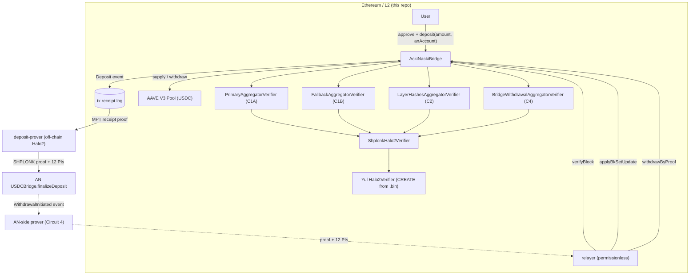

# Ethereum Contracts — Implementation Specification

**Status:** as-implemented (descriptive, not aspirational).
**Derived from:** the Solidity sources under `contracts/ethereum/` at commit `4021c68`
(`Merge branch 'main' into pruvendo/eth-39-withdraw`), `2026-09-25`. This is the baseline
for `file:line` citations; the dated drift notes below identify later updates.
Unchecked citations retain their earlier bases and are not current-source offsets.
When editing the spec, either re-run the re-anchoring pass or leave a fresh dated
note here calling out the drift.

> **Drift note, 2026-10-12 (ETH-28).** The AAVE behaviour in §6 (payout top-up), §10 and §11
> describes the code after `writeOffUnbackedPrincipal` landed; the line numbers in those rows
> are still those of `4021c68`. `writeOffUnbackedPrincipal`, `_backedPrincipal`,
> `AaveSupplyFailed`, `NothingToWriteOff`, `HarvestWouldBreakSolvency` and
> `UnbackedPrincipalWrittenOff` did not exist at that commit and carry no line number.
>
> **Drift note, 2026-10-14** (after merging `main`): `src/AckiNackiBridge.sol` has grown since
> `4021c68` — the pause switch, then the bundle-aware `applyBkSetUpdate` rule, `bundleStride` and
> `genesisLastBkSetUpdateSeqNo` — and no re-anchoring pass has been run since. Citations below that
> were not re-checked point too early: by about 30 lines around `HistoryWindow` (`:259` → `:289`)
> and by about 100–160 from `deposit` on (`:672` → `:772`, `applyBkSetUpdate` `:898` → `:1011`,
> `transferOwnership` `:1565` → `:1720`). Checked against the source at that time: §4.1's storage table
> (slots with `forge inspect`), the `whenNotPaused` and `pause()` / `unpause()` citations (`:536`,
> `:1685`, `:1692`), §4.2's `bundleStride` row (`:234`), §4's `InvalidBundleStride` (`:714`), and
> §7.3's description of the rotation gate.
>
> **Drift note, 2026-10-19.** Trade-off 3's *Deploy mode* paragraph (§15) was checked against
> `98df1a95`; its `:234` and `:1170-1181` are that commit's lines.

> **Drift note, 2026-10-20 (workchain removal).** The deposit references in §6 and
> `whenNotPaused` references in §§6–7 use `src/AckiNackiBridge.sol` at `9604d14`:
> `deposit` is at `:774-785`, `whenNotPaused` at `:547-550`, and the exact-transfer
> check at `:1538-1547`. Client and prover references in §6 follow the same ABI
> change. Earlier drift notes describe historical snapshots; other citations
> have not been re-anchored by this change. Locate symbols in current source
> before relying on their line offsets.
>
> **Drift note, 2026-11-02 (withdrawal proofs name their EVM bridge, gosh-sh/bridge-audit#140).**
> §4.1's `treasuryBalance`, `_nullifiers` and `_layerWindows` rows, §4.2's `predecessor` row, §5's
> `BridgeWithdrawConfig`, predecessor and `genesisBkSetCommitment` rows, all of §7.2, §7.4's
> `isNullifierUsed` row, §10's `fundTreasury` / `migrateTreasury` rows, §12.1's `DeployRealBridge`
> row, §12.2's `WIRE_VERIFY_BLOCK` and `PREDECESSOR_BRIDGE` rows and §15's invariant 2 cite
> `src/AckiNackiBridge.sol`, `src/IBridgeWithdrawalVerifier.sol`, `script/DeployRealBridge.s.sol`
> and `script/PredecessorEnv.sol` as of this change. Other citations were not re-anchored.
>
> **Drift note, 2026-11-04 (AAVE band, Arbitrum only).** `supplyToAave` is gone: `deposit`
> supplies above the liquid target and `withdrawByProof` refills it (§10). AAVE is mandatory, the
> bridge is Arbitrum Sepolia only, and `supplyMultiplierBps` took slot 5, moving every later slot
> by one (§4.1). §4.1, §5's AAVE rows, §10, §11's AAVE names, §12 and §13 are re-anchored to this
> change; the note below is history.
>
> **Drift note, 2026-11-04 (Arbitrum Sepolia AAVE).** §10, §12.1, §12.2, §12.3 and §13
> now include chain id 421614. `DeployRealBridge._resolveTokenAddresses` accepts it.
> `USE_AAVE` defaults false, and `USE_AXIOM_ORACLE=true` reverts on this chain. The
> `DeployRealBridge.s.sol` citations in the constructor table (`:160`) and in §12
> (`:152`, `:155`, `:165-166`, `:171`, `:283`) are re-anchored to this script. The constructor
> table's `genesisBkSetCommitment` and verifier-triple rows were wrong: the constructor reverts
> `ZeroBkSetCommitment` (`src/AckiNackiBridge.sol:763`) and `PartialVerifyBlockWiring` (`:743`);
> with no verifier set, `verifyBlock` reverts `VerifyBlockDisabled` (`:934`). Other citations were
> not re-anchored.

**Method:** written by reading the contract sources only. No pre-existing prose was used as input;
where the older documentation and the code disagree, the divergences are itemised in §16.

> **Path convention.** Every behavioural claim below cites `file:line`. Bare paths beginning
> `src/`, `test/`, `script/` or `verifiers/` are relative to **`contracts/ethereum/`** — this
> document was written next to those sources and moved to `docs/` on 2026-08-18 without rewriting
> its ~400 citations. So `:578` and `src/AckiNackiBridge.sol:578` both mean
> `contracts/ethereum/src/AckiNackiBridge.sol:578`. Any other path is relative to the repository
> root.
>
> Where the code and a comment inside the code disagree, the code wins and the divergence is
> called out.

---

## 1. Scope

This document specifies the complete Ethereum-side contract system: the bridge contract, the ZK
verifier stack it calls, the block-header oracle interface, the deploy scripts, and the on-chain
ABI surface that off-chain components depend on.

Out of scope (referenced only where the EVM side binds to them): the Acki Nacki (AN) TVM contracts,
the Halo2 circuits themselves, and the Rust prover/relayer crates.

### 1.1 File inventory

| Path | Lines | Role |
|---|---:|---|
| `src/AckiNackiBridge.sol` | 1403 | **The bridge.** Custody, deposits, AN-state commitment, withdrawal payout, AAVE yield. |
| `src/IPrimaryVerifier.sol` | 36 | Circuit 1A (primary attestation) verifier interface — 4 PIs. |
| `src/IFallbackVerifier.sol` | 33 | Circuit 1B (fallback attestation) verifier interface — 4 PIs. |
| `src/ILayerHashesMovementVerifier.sol` | 45 | Circuit 2 (layer-hash movement) interface — 14 PIs. |
| `src/IBridgeWithdrawalVerifier.sol` | 83 | Circuit 4 (bridge withdrawal event) interface — 12 PIs. |
| `src/ShplonkAggregatorVerifierBase.sol` | 32 | Shared adapter base: instance reader + SHPLONK dispatch. |
| `src/PrimaryAggregatorVerifier.sol` | 30 | 1A adapter (instances[12..15] ↔ args). |
| `src/FallbackAggregatorVerifier.sol` | 30 | 1B adapter (instances[12..15] ↔ args). |
| `src/LayerHashesAggregatorVerifier.sol` | 34 | Circuit-2 adapter (instances[12..25] ↔ args). |
| `src/BridgeWithdrawalAggregatorVerifier.sol` | 44 | Circuit-4 adapter (instances[12..=23] ↔ `pub`, twelve slots; `vkDigest` at 24). |
| `src/ShplonkHalo2Verifier.sol` | 31 | `staticcall` shim onto CREATE-deployed Yul verifier bytecode. |
| `src/IShplonkHalo2Verifier.sol` | 7 | `verify(bytes) → bool`. |
| `src/IBlockHeaderOracle.sol` | 27 | Block-hash oracle interface. |
| `src/AxiomBlockHeaderOracle.sol` | 186 | Axiom V2 Core–backed oracle implementation. |
| `src/MockBlockHeaderOracle.sol` | 76 | Test/E2E oracle (owner-settable hashes + `blockhash()` fallback). |
| `src/IAavePool.sol`, `src/IERC20.sol` | 47 / 12 | Minimal external interfaces. |
| `verifiers/*.bin` | — | Production SHPLONK Yul **creation** bytecode (4 circuits). |
| `verifiers/*_calldata.bin` | — | Reference `instances ‖ proof` calldata fixtures. |
| `verifiers/{Primary,Fallback,LayerHashes}AggregatorVerifier.sol` | 82–92 KB | Generated `Halo2Verifier` Yul-in-Solidity sources (reference; the `.bin` is what deploys). |
| `script/*.s.sol`, `script/ShplonkDeployLib.sol` | 61–349 | Deployment. See §8. |
| `test/**` | ~3.4 k | Foundry tests + mocks + fixtures. See §9. |

Nothing under `contracts/ethereum/` is upgradeable: there is no proxy, no admin-upgrade path, and
every verifier binding is `immutable`. Changing a verifier or an identity constant means deploying a
new bridge.

---

## 2. System overview



Two independent directions:

* **ETH → AN (deposit).** Purely an event emission on this side (`AckiNackiBridge.deposit`,
  `src/AckiNackiBridge.sol:672`). No Ethereum-side proof verification is involved; the event's log
  is proven off-chain and consumed natively by the AN `USDCBridge`. The bridge keeps custody of the
  USDC.
* **AN → ETH (state attestation + payout).** `verifyBlock` (`:739`) advances a rolling commitment to
  AN state from two cross-bound ZK proofs; `withdrawByProof` (`:1295`) pays out USDC against a
  Circuit-4 proof anchored into state that `verifyBlock` already recorded. `applyBkSetUpdate`
  (`:898`) rotates the AN validator-set (BK-set) commitment.

There is **no** `withdraw(depositId, …)` refund path; the withdrawal surface consists solely of
`withdrawByProof`, described in §7.2.

---

## 3. `AckiNackiBridge` — constants

| Constant | Value | Line | Meaning |
|---|---|---:|---|
| `USDC_UNIT` | `10**6` | 50 | USDC has 6 decimals. Declared, not used internally. |
| `MAX_DEPOSIT_AMOUNT` | `type(uint64).max` | 55 | First deposit width guard (`DepositTooLarge`); the product limit below is lower. |
| `MAX_TRANSFER_AMOUNT` | `50 * USDC_UNIT` | 57 | 50 USDC per deposit or withdrawal (`TransferTooLarge`). |
| `MAX_BRIDGE_TVL` | `10_000 * USDC_UNIT` | 58 | Per-contract cap on `treasuryBalance`, including Aave principal, checked by `deposit` only (`TvlCapReached`); `fundTreasury` can take the book past it. |
| `BPS_DENOMINATOR` | `10_000` | 58 | Basis-point denominator. |
| `MAX_LIQUID_RESERVE_BPS` | `5_000` | 61 | Liquid reserve is capped at 50 %. |
| `MAX_LAYER_HASHES` | `10` | 65 | Layer slots per AN block (mirrors Circuit 2 `MAX_LAYERS`). |
| `HISTORY_PROOF_WINDOW` | `128` | 80 | Rolling-window depth **per layer**. |
| `BN254_R` | `0x30644e72…f0000001` | 84 | BN254 scalar field order; used only by `applyBkSetUpdate` to reduce a SHA-256 root into `Fr`. |
| `RECIPIENT_HALF_MASK` | `(1 << 80) - 1` | 1253 | 10-byte half of a split-α recipient address. |

`enum FinalizationType { Primary, Fallback }` (`:90`) mirrors the AN attestation circuit's binary
split (≥ 2/3 quorum vs > 1/2 split).

---

## 4. Storage

### 4.1 Mutable state (declaration order)

Slots below are the output of `forge inspect AckiNackiBridge storage-layout`; re-run it before
relying on them for a storage-level migration.

| Slot | Offset | Var | Type | Line | Written by |
|---:|---:|---|---|---:|---|
| 0 | 0 | `depositCounter` | `uint256` | 109 | `deposit` |
| 1 | 0 | `treasuryBalance` | `uint256` | 113 | `deposit` (+), `fundTreasury` (+), `withdrawByProof` (−), `migrateTreasury` (→ 0) |
| 2 | 0 | `blockHeaderOracle` | `IBlockHeaderOracle` | 119 | constructor only |
| 2 | 20 | `aaveEnabled` | `bool` | 135 | constructor, `setAaveEnabled`, `emergencyWithdrawAll` |
| 3 | 0 | `suppliedPrincipal` | `uint256` | 138 | `deposit` (+, through `_supplyAboveTarget`), `withdrawByProof` and `withdrawFromAave` (−, through `_bookPull`), `emergencyWithdrawAll`, `writeOffUnbackedPrincipal` |
| 4 | 0 | `liquidReserveBps` | `uint256` | 143 | constructor (`1_000`), `setLiquidReserveBps` |
| 5 | 0 | `supplyMultiplierBps` | `uint256` | 148 | constructor (`20_000`), `setSupplyMultiplierBps` |
| 6 | 0 | `owner` | `address` | 151 | constructor, `acceptOwnership` |
| 7 | 0 | `pendingOwner` | `address` | 154 | `transferOwnership`, `acceptOwnership` |
| 8 | 0 | `yieldRecipient` | `address` | 157 | constructor, `setYieldRecipient`, `acceptOwnership` (when it was the previous owner) |
| 8 | 20 | `paused` | `bool` | 163 | `pause`, `unpause` |
| 9 | 0 | `_reentrancyStatus` | `uint256` | 168 | `nonReentrant` |
| 10 | 0 | `storedBkSetCommitment` | `uint256` | 196 | constructor, `applyBkSetUpdate` |
| 11 | 0 | `storedLastBkSetUpdateSeqNo` | `uint64` | 203 | `applyBkSetUpdate` |
| 11 | 8 | `storedLastSeenBlockSeqNo` | `uint64` | 207 | constructor, `verifyBlock` |
| 12 | 0 | `storedPrevBkSetCommitment` | `uint256` | 214 | `applyBkSetUpdate` |
| 13 | — | `_nullifiers` | `mapping(bytes32 ⇒ bool)` | 306 | `withdrawByProof` |
| 14 | — | `_layerWindows` | `mapping(uint8 ⇒ HistoryWindow)` | 325 | `_appendLayer` |

`blockHeaderOracle` is **write-only in practice**: it is set in the constructor (`:588`) and never
read anywhere in `src/`. It is retained for a future burn-proof flow (`:106-110`).

### 4.2 Immutables (no storage)

| Var | Type | Line | Notes |
|---|---|---:|---|
| `usdc` | `IERC20` | 117 | Deposit/payout token. Must be non-zero. |
| `aavePool`, `aUSDC` | `IAavePool`, `IERC20` | 120, 123 | Both zero ⇒ AAVE disabled; exactly one zero ⇒ constructor reverts. |
| `primaryVerifier`, `fallbackVerifier`, `layerHashesVerifier` | interfaces | 159, 165, 171 | Any zero ⇒ `verifyBlock` disabled. |
| `bundleStride` | `uint64` | 234 | Prover bundle width in block seq-nos (L1 = 1024, L2 = 16384); divisor in the `applyBkSetUpdate` boundary invariant. Mandatory when the verifier triple is wired; may be zero when `verifyBlock` is disabled. L1↔L2 switch requires a redeploy. |
| `storedPrevMaxLevelLayerHash` | `uint256` | 204 | **Genesis seed only** since storage v2.0 (2026-08-04). Read exclusively by `_expectedPrevAnchor` when no layer window is populated (`:1118`). |
| `bridgeWithdrawalVerifier` | `IBridgeWithdrawalVerifier` | 218 | Zero ⇒ `withdrawByProof` disabled. |
| `bridgeWithdrawalDappFr`, `bridgeWithdrawalAccFr` | `uint256` | 226, 229 | AN-side bridge identity the C4 proof must bind to. |
| `bridgeWithdrawalAltDstChainId`, `bridgeWithdrawalAltDstHostChainId`, `bridgeWithdrawalAltTokenId` | `uint256` | 232, 236, 239 | Shellnet/testnet aliases (§7.2). |
| `predecessor` | `IPredecessorBridge` | 281 | The bridge this deployment replaces on the same chain, or zero. It only authorizes the treasury handover: it may call `fundTreasury`, and its `migrateTreasury` accepts only a bridge that names it here (§10). Replay needs nothing from it (§7.2). Immutable, so no storage slot changes. |

### 4.3 `HistoryWindow` (`:259-271`)

```solidity
struct HistoryWindow {
    uint256[128] data;      // layer-hash values, circular
    uint64[128]  heights;   // ABI-stable, always zero; seq_nos are in LayerAnchorAppended
    uint16 dataLen;         // saturating fill level, capped at 128
    uint16 writeCursor;     // next write index
    uint64 lastHeight;      // height of the most recent append
}
```

One window per layer `L ∈ [1, 10]`, in `_layerWindows`. `heights` is ABI-stable but
**not written** on `verifyBlock` — `lastHeight` is the monotonicity guard, and
per-slot seq_nos are in `LayerAnchorAppended`. The relayer paints `heights` from
those logs on resurrect. This is the **authoritative** AN-state store;
the flat `storedNumLayers` / `storedLayerHashes[10]` cache was removed in storage v2.0 along with the
per-block `storedPrevMaxLevelLayerHash` SSTORE (`:846-852`, ≈ 32 k gas/call saved).

---

## 5. Constructor and deployment configuration

```solidity
constructor(
    address _blockHeaderOracle,   // required, non-zero, never read afterwards
    address _usdc,                // required, non-zero
    address _aavePool,            // 0 ⇒ AAVE disabled
    address _aUSDC,               // 0 ⇒ AAVE disabled
    VerifyBlockConfig memory _vb,
    BridgeWithdrawConfig memory _bw
)                                                        // :572-644
```

`VerifyBlockConfig` (`:495-516`): `primaryVerifier`, `fallbackVerifier`, `layerHashesVerifier`,
`genesisBkSetCommitment`, `genesisPrevMaxLevelLayerHash`, `genesisLastSeenBlockSeqNo`,
`bundleStride`. `bundleStride` is the prover's bundle width in block seq-nos (W·P = 1024 for L1,
W² = 16384 for L2) and is immutable after construction; `applyBkSetUpdate` divides by it to detect
whether a second rotation would cross an unverified bundle boundary. When the verifier triple is
wired, `bundleStride != 0` is required (else `InvalidBundleStride`, `:714`); when the triple is
unwired (`verifyBlock` disabled) the field is unused and may be zero.

`BridgeWithdrawConfig` (`:662-693`): `bridgeWithdrawalVerifier`, `dappFr`, `accFr`, `altDstChainId`,
`altDstHostChainId`, `altTokenId`, `predecessor`. `predecessor` is the `AckiNackiBridge` on the same
chain whose treasury this deployment may take over, or zero. It is the last field, so the
constructor's ABI signature changed when it was added.

Validation performed (and *not* performed):

| Check | Line | Behaviour |
|---|---:|---|
| `_blockHeaderOracle != 0` | 580 | else `InvalidOracle` |
| `_usdc != 0` | 581 | else `InvalidUsdc` |
| `_aavePool != 0` and `_aUSDC != 0` | 754 | else `InvalidAaveAddress`. AAVE is mandatory on every chain. |
| C4 verifier set ⇒ `accFr != 0` | 600-608 | else `InvalidBridgeWithdrawalIdentity`. **`dappFr == 0` is legal** (shellnet zero-`dapp_id` deployments), despite the NatSpec at `:568-569` saying both must be non-zero. Test `test_constructor_withdrawEnabledWithZeroDappFr_succeeds` pins the code behaviour. |
| C4 verifier set ⇒ `dappFr`, `accFr`, `altTokenId` canonical Fr | | else `FieldElementOutOfRange`. Zero remains legal for `dappFr` and `altTokenId`. |
| `genesisBkSetCommitment != 0` when the verifier triple is wired | 763 | else `ZeroBkSetCommitment`. Checked only when all three verifiers are set; `script/DeployRealBridge.s.sol:160` checks it before the deploy too. |
| `predecessor != 0` ⇒ C4 verifier set, the address has code, and returns this deployment's `dappFr` and `accFr` from `bridgeWithdrawalDappFr()` / `bridgeWithdrawalAccFr()` | 793-795, 811-826 | else `InvalidPredecessor(address)`. Code at the address on this chain is what ties the predecessor to this chain; the identity check ties it to the same AN-side bridge. A probe that reverts gives `InvalidPredecessor`; one whose return data does not decode reverts the deployment without a reason. Whether the predecessor is paused is not checked. |
| verifier triple is all-or-nothing | 743 | else `PartialVerifyBlockWiring`. Test `test/AckiNackiBridgeWithdrawByProof.t.sol:305` pins it. With no verifier set, `verifyBlock` reverts `VerifyBlockDisabled` at call time (`:934`). |

Post-conditions: `owner = yieldRecipient = msg.sender`, `aaveEnabled = true`,
`liquidReserveBps = 1_000` (10 %), `supplyMultiplierBps = 20_000` (2×), reentrancy guard armed, `OwnershipTransferred(0, msg.sender)`
emitted (`:637-643`).

---

## 6. ETH → AN: deposits

```solidity
function deposit(uint256 amount, bytes32 anAccount) external nonReentrant whenNotPaused  // :774
```

`whenNotPaused`: reverts `BridgePaused()` while `paused` is true (`:547-550`).

Sequence (`:774-785`):

1. `amount != 0` else `InvalidAmount`.
2. `amount <= MAX_DEPOSIT_AMOUNT` else `DepositTooLarge`, then
   `amount <= MAX_TRANSFER_AMOUNT` else `TransferTooLarge`.
3. `anAccount != 0` else `InvalidAnAccount` — an EVM address is not a valid AN recipient, so the
   256-bit TVM destination is supplied explicitly.
4. `treasuryBalance + amount <= MAX_BRIDGE_TVL` else `TvlCapReached`, before any token call.
5. `_pullExactUsdc(amount)` calls `usdc.transferFrom`; a `false` return ⇒ `TransferFromFailed`.
   The received balance delta must equal `amount`, else `TransferAmountMismatch` (`:1538-1547`).
6. `depositId = depositCounter++`, `treasuryBalance += credited`.
7. `emit Deposit(depositId, msg.sender, amount, anAccount, block.timestamp)`.

Notes that matter downstream:

* Funds stay as plain USDC in the contract; batching into AAVE is a separate owner action (§10).
* The received amount must match the requested amount exactly; a fee-on-transfer token is
  rejected before `depositCounter` or `treasuryBalance` changes (`:1538-1547`).
* The `Deposit` **event layout is a hard cross-repo ABI**: the off-chain prover parses
  `topics[1] = depositId`, `topics[2] = sender`, and reads three data words:
  `amount` at bytes 0..32, `anAccount` at 32..64, and `timestamp` at 64..96.
  Parsing starts in `deposit-prover/src/ethereum_fetcher.rs:58`. The circuit constrains
  the 96-byte data length (`deposit-prover/src/circuit_v2.rs:834-835`) and binds the
  account from word 1 (`:1009-1011`).
  This format requires the matching deposit VK; the earlier workchain-bearing
  event and its proofs are incompatible.
* The proof's 12 public inputs are `deposit_id, sender, amount, contract_address, chain_id,
  dapp_id_{high,low}, an_account_{high,low}, block_hash_{high,low}, promise_commit`
  (`crates/deposit-relayer-daemon/src/types.rs:98-110`). The DApp ID remains a
  config-supplied tag; removing workchain does not change its meaning or PI slots.
  Those 12 values are the only deposit data the proof can change. The private witness is
  longer: the receipt and the log sit in fixed-length buffers with an unused tail, and a
  different tail is another witness of the same public inputs, not another deposit.
  [`deposit-prover/README.md`](../deposit-prover/README.md) names the buffers.
* Deposits are provable from an allowlisted set of chains: OP Mainnet (10), World Chain (480),
  Mantle (5000), Base (8453), Arbitrum One (42161), Blast (81457), Sepolia (11155111)
  (`crates/deposit-chain-ids/src/lib.rs:30-38`). Ethereum mainnet (1) is **not** in that list. The
  contract itself is chain-agnostic; the constraint lives in the prover/relayer allowlist and the
  AN-side `(chainId → bridge Fr)` allowlist.

---

## 7. AN → ETH

`withdrawByProof` also refuses `pub.amount > MAX_TRANSFER_AMOUNT` with
`TransferTooLarge` before proof verification or nullifier consumption. The
10,000 USDC cap applies to each funded L1 bridge separately. Pair it with AN
1.13.0 chain accounting and complete old transfers before activating a fresh
pair; see [the deployment procedure](../contracts/an/README.md#deployment).
No EVM storage slots or deposit/withdrawal argument shapes change with these limits.

### 7.1 `verifyBlock` — advance the AN state commitment

```solidity
function verifyBlock(
    FinalizationType finType,
    bytes calldata attestationProof,
    bytes calldata layerHashesProof,
    uint256 blockId,
    uint256 bkSetCommitment,
    uint64  blockSeqNo,
    uint8   numLayers,
    uint256[10] calldata layerHashes,
    uint256 prevMaxLevelLayerHash
) external nonReentrant whenNotPaused                     // :739-857
```

`whenNotPaused`: reverts `BridgePaused()` while `paused` is true (`:547-550`).

Permissionless. Order of operations is deliberately cheap-checks-first, then crypto, then effects:

| # | Check | Line | Revert |
|---:|---|---:|---|
| 1 | all three verifier slots non-zero | 750 | `VerifyBlockDisabled` |
| 2 | `1 ≤ numLayers ≤ 10` | 759 | `InvalidNumLayers` |
| 3 | `layerHashes[i] == 0` for `i ≥ numLayers` | 762 | `LayerHashTailNonZero(i)` |
| 4 | `layerHashes[i] != 0` for `i < numLayers` | 767 | `LayerHashActiveZero(i)` (QC-A2-3: a zero active slot would let `_appendLayerHashes` skip a layer and desync the windows) |
| 5 | `bkSetCommitment == storedBkSetCommitment` | 777 | `BkSetCommitmentMismatch` |
| 6 | `blockSeqNo > storedLastSeenBlockSeqNo` | 785 | `BlockSeqNoNotMonotonic` |
| 7 | `prevMaxLevelLayerHash == _expectedPrevAnchor(numLayers)` | 797-802 | `PrevAnchorMismatch` |
| 8 | attestation proof accepted (1A or 1B per `finType`) | 812-832 | `AttestationProofRejected` |
| 9 | layer-hash proof accepted | 834-844 | `LayerHashesProofRejected` |

The attestation call passes the **pre-update** `storedLastSeenBlockSeqNo` as the circuit's
`lastSeenBlockSeqNo` public input (`:820`, `:828`) — that is what binds the submitted block to the
contract's current cursor inside the proof, in addition to check 6.

Cross-circuit binding: the same `blockId` and `bkSetCommitment` values are forwarded to both
verifiers, and each adapter compares them byte-for-byte against instances read out of its own proof
(§8.1). Two proofs about different AN blocks therefore cannot both pass with one argument set.

Effects, in CEI order (`:853-856`):

* `storedLastSeenBlockSeqNo = blockSeqNo`;
* `_appendLayerHashes(numLayers, layerHashes, blockSeqNo)` — for `L = 1..numLayers`, append
  `layerHashes[L-1]` into window `L` (`:1028-1039`);
* `emit BlockVerified(blockId, blockSeqNo, finType, numLayers)` plus one
  `LayerAnchorAppended(L, hash, height)` per appended layer (`:1058`).

`_appendLayer` (`:1042-1059`) additionally enforces `1 ≤ layer ≤ 10` (`LayerOutOfRange`) and
`blockHeight >= w.lastHeight` (`NonMonotonicLayerHeight`, non-strict), then writes at `writeCursor`,
advances the cursor mod 128, saturates `dataLen` at 128, and records `lastHeight`.

The contract does **not** require `blockSeqNo == storedLastSeenBlockSeqNo + 1`; gaps are permitted
(covered by `test_relayerLoop_seqNoFastForward_isPermittedByContract`). Continuity is the prover's
and relayer's responsibility.

#### Chain anchor: `_expectedPrevAnchor` (`:1115-1122`)

```
t = _highestActiveLayer()                  // highest L with dataLen > 0, else 0
if t == 0: return storedPrevMaxLevelLayerHash    // immutable genesis seed
pick = min(numLayers, t)
return _layerLatest(pick)                  // head of window `pick`
```

A flat `layerHashes[numLayers - 1]` anchor diverges whenever `numLayers` *decreases* between
consecutive key blocks, which would halt `verifyBlock` permanently (AB-Q4). Relayers compare
the bundle's Circuit 2 instance 13 with `expectedPrevAnchor(numLayers)` (`:1283`) before sending;
they do not pick the cell.

`t` is the highest populated window (`dataLen > 0`), not the last block's `numLayers`. Nothing
clears a window, so `t` never decreases when later key blocks skip higher layers. The prover's
`prev_max_level_layer_hash_for` must use the same `t`; any other pick reverts `PrevAnchorMismatch`
before the proofs are checked. A cold-start `BridgeState` that was seeded with every layer of
its bootstrap block can disagree with a contract that still has empty windows; that is a
separate gap.

### 7.2 `withdrawByProof` — pay out a proven AN withdrawal

```solidity
function withdrawByProof(
    bytes calldata proof,
    IBridgeWithdrawalVerifier.WithdrawalPublicInputs calldata pub
) external nonReentrant whenNotPaused returns (bool success)  // :1513-1605
```

`whenNotPaused`: reverts `BridgePaused()` while `paused` is true (`:586-589`).

Permissionless; gas is paid by the caller (typically a relayer) while funds go to `recipient`.

Public inputs (`src/IBridgeWithdrawalVerifier.sol:35-72`), slots `[0..11]` in circuit order:
`tokenId, amount, recipientHi, recipientLo, dstChainId, senderAccFr, dappFr, accFr, nullifier,
finalRoot, anchorLayer, dstBridge`.

| # | Check | Line | Revert |
|---:|---|---:|---|
| 1 | C4 verifier wired | 1517-1519 | `WithdrawByProofDisabled` |
| 2 | `pub.amount ≤ MAX_TRANSFER_AMOUNT` | 1521 | `TransferTooLarge` |
| 3 | `pub.dstBridge == uint160(address(this))` | 1524-1526 | `WrongDstBridge(dstBridge)` |
| 4 | `pub.dappFr == bridgeWithdrawalDappFr && pub.accFr == bridgeWithdrawalAccFr` | 1527-1529 | `WithdrawIdentityMismatch` |
| 5 | `pub.dstChainId == block.chainid`, **or** the scoped alias: `altDstChainId != 0 && altDstHostChainId != 0 && block.chainid == altDstHostChainId && pub.dstChainId == altDstChainId` | 1530-1537 | `DstChainIdMismatch` |
| 6 | `pub.tokenId == 0`, **or** `altTokenId != 0 && pub.tokenId == altTokenId` | 1538-1542 | `UnsupportedTokenId` |
| 7 | `recipientHi ≤ 2^80-1`, `recipientLo ≤ 2^80-1` | 1543-1548 | `RecipientHalfOutOfRange` |
| 8 | reconstructed recipient `!= address(0)` (WD-Q2: checked *before* the expensive verify) | 1551-1553 | `InvalidRecipient` |
| 9 | `nullifier`, `finalRoot`, `anchorLayer` are canonical Fr | 1557-1559 | `FieldElementOutOfRange` |
| 10 | `!_nullifiers[bytes32(pub.nullifier)]` | 1561-1563 | `NullifierAlreadyUsed` |
| 11 | `1 ≤ pub.anchorLayer ≤ MAX_LAYER_HASHES` | 1564-1568 | `LayerOutOfRange` |
| 12 | `_isKnownLayerAnchor(uint8(pub.anchorLayer), pub.finalRoot)` | 1569-1571 | `UnknownAnchor` |
| 13 | `bridgeWithdrawalVerifier.verifyWithdrawal(proof, pub)` | 1577-1578 | `WithdrawalProofRejected` |
| 14 | `pub.amount ≤ treasuryBalance` | 1581-1583 | `WithdrawTreasuryShortfall` |

Effects then interactions (`:1586-1603`): mark the nullifier used, `treasuryBalance -= amount`;
then, if liquid USDC < `amount`, pull exactly the shortfall back from AAVE through `_pullFromAave`
— bounded by `aUsdcBalance()`, not by `suppliedPrincipal`, so interest above the book can fund a
payout; an aToken balance below the shortfall reverts `InsufficientTreasury`; then `usdc.transfer(recipient, amount)` (`false` ⇒ `WithdrawTransferFailed`); then
`emit WithdrawalByProofExecuted(nullifier, recipient, amount, tokenId, msg.sender)`. Returns `true`.

Recipient reconstruction is split-α: `address(uint160((hi << 80) | lo))` (`:1652-1656`).

**Anchor semantics.** `_isKnownLayerAnchor` (`src/AckiNackiBridge.sol`) scans
only the window named by Circuit 4's 1-indexed `anchorLayer` public input
(`1..=MAX_LAYER_HASHES`, also range-checked in-circuit). A proof whose
`finalRoot` sits in a different layer's window is rejected (`UnknownAnchor`),
even if that root is a genuine `verifyBlock` anchor. A miss costs at most
128 cold SLOADs, paid by the caller whose call then reverts.

**Replay scope.** A proof names the one EVM bridge that may pay it. `eccUSDCBridge` writes the
bridge its owner set for the destination chain (`setEvmBridge`) into `WithdrawalInitiated`;
Circuit 4 publishes those event-body bytes as `dstBridge` (slot 11); check 3 refuses any other
address. A second bridge on the same chain — earlier or later, paused or not — therefore cannot pay
a burn that names the first, and the nullifier map can stay per-contract with no cross-bridge
lookup. `dstChainId` keeps a proof off deployments on other chains. The
`altDstHostChainId` field exists precisely so a shellnet proof for logical chain `1` cannot execute
on a deployment whose host chain is not the configured one. The rotated
Circuit 4 key binds `events_pos` (the events-tree leaf index) into the
nullifier, so two identical burns in one AN block mint distinct
nullifiers (trade-off 12).

### 7.3 `applyBkSetUpdate` — rotate the BK-set commitment

```solidity
function applyBkSetUpdate(
    FinalizationType finType,
    bytes calldata attestationProof,
    uint256 blockId,
    uint64  blockSeqNo,
    uint64  attestationLastSeen,
    uint256 oldCommitmentL2,
    uint256 newCommitmentL3,
    bytes32 siblingH01,
    bytes32 siblingH4_7,
    bytes32 siblingH8_15
) external nonReentrant whenNotPaused                     // :898-1004
```

`whenNotPaused`: reverts `BridgePaused()` while `paused` is true (`:547-550`).

Permissionless. Gate: `primaryVerifier` and `fallbackVerifier` both non-zero (`:909`, note
`layerHashesVerifier` is **not** required) else `BkUpdateDisabled`.

1. `oldCommitmentL2 == storedBkSetCommitment` else `StaleBkSetCommitment` (`:913`).
2. `blockSeqNo > storedLastBkSetUpdateSeqNo` else `BkUpdateSeqNoNotMonotonic` (`:916`) — an
   **independent** cursor from `storedLastSeenBlockSeqNo`.
3. Attestation proof verified with `(blockId, oldCommitmentL2, blockSeqNo, storedLastSeenBlockSeqNo)`
   (`:947-965`).
4. Open the depth-4 / 16-leaf block-id tree at leaves 2 and 3 (`:980-985`):

   ```
   h23   = SHA256( LE32(oldCommitmentL2) ‖ LE32(newCommitmentL3) )
   h0_3  = SHA256( siblingH01 ‖ h23 )
   h0_7  = SHA256( h0_3       ‖ siblingH4_7 )
   root  = SHA256( h0_7       ‖ siblingH8_15 )
   require( root mod BN254_R == blockId )      // else BkUpdateMerkleMismatch
   ```

   The two commitments are byte-reversed to little-endian first (`_frToLeBytes`, `:1017-1024`) because
   the AN side hashes canonical `Fr::to_repr()`; the siblings are opaque SHA-256 outputs and are not
   reversed. The `% BN254_R` reduction (`:995`) reconciles the raw SHA-256 root with the canonical
   `Fr` image that the attestation adapter compares against — without it roughly four rotations in
   five would be unsatisfiable by any argument.

5. Effects: `storedBkSetCommitment = newCommitmentL3`, `storedLastBkSetUpdateSeqNo = blockSeqNo`,
   `emit BkSetUpdated(old, new, blockSeqNo)` (`:1000-1003`).

Before step 5, the contract enforces the **bundle-boundary invariant**: if
`storedLastBkSetUpdateSeqNo != 0`, compute
`nextOwedBoundary = ((storedLastSeenBlockSeqNo / bundleStride) + 1) * bundleStride`
and revert `PrevSlotStillOwedForBundle(storedLastBkSetUpdateSeqNo, nextOwedBoundary)` when
`nextOwedBoundary <= storedLastBkSetUpdateSeqNo`. The guard only trips when the previous
rotation's seq-no sits at or past the next bundle target the chain still owes; the incoming
rotation's own seq-no plays no part. Rotations therefore apply back-to-back until one lands at
or past that target, and the next one reverts until `verifyBlock` has advanced
`storedLastSeenBlockSeqNo` to the last boundary at or below that previous seq-no. With
`bundleStride = 16384` and the cursor at 0: N1 = 10 then N2 = 16389 both apply, although N2
crosses a boundary; N1 = 16394 then N2 = 16397 lie in one window, yet N2 reverts until
`verifyBlock(16384)`.

`storedLastSeenBlockSeqNo` is **not** advanced by a rotation.

**Operator rule.** Attestation `lastSeen` is the word the Circuit 1A/1B
proof was baked against (`block_seq_no > last_seen`). That is the layer
cursor at prove time, typically the previous key block — not
`storedLastSeenBlockSeqNo` after `verifyBlock(N)`, which equals N and
makes the circuit unsatisfiable. `storedLastBkSetUpdateSeqNo` selects
the set and gates the next rotation. A rotation can be applied before
the layer cursor reaches N; `verifyBlock` accepts the outgoing set for
`seqNo <= N`. AN must announce a rotation at bundle target N
*before* that bundle is proven: a proof that already baked
`last_seen = N` cannot satisfy `attestationLastSeen < N`. A burst of
rotations applies in order until one lands at or past the next owed
bundle target; the rest wait for `verifyBlock` to reach the last
boundary at or below it — usually just that one bundle.

### 7.4 Read surface for AN state

| View | Line | Returns |
|---|---:|---|
| `expectedPrevAnchor(uint8 numLayers)` | 1283 | The anchor the next `verifyBlock` will require. |
| `getLatestPerLayer()` | 1156 | `uint256[10]`, entry `[L-1]` = head of window `L` (0 if empty). Replaces the removed `getStoredLayerHashes()`. |
| `isKnownAnchor(uint256)` | 1173 | Flat membership across all 10 windows. **Not** the `withdrawByProof` predicate — a monitor that pre-checks only this view will accept a proof the contract then rejects if `anchorLayer` names a different window. |
| `isKnownLayerAnchor(uint8, uint256)` | 1212 | Membership in one window. This is what `withdrawByProof` uses. |
| `isNullifierUsed(uint256)` | 1610 | Replay pre-check for relayers: `true` when this bridge paid the nullifier, which is exactly when `withdrawByProof` reverts `NullifierAlreadyUsed`. |

---

## 8. Verifier stack

```
AckiNackiBridge
  └─ I{Primary,Fallback,LayerHashesMovement,BridgeWithdrawal}Verifier
       └─ *AggregatorVerifier          (typed adapter: instance ↔ argument equality)
            └─ ShplonkHalo2Verifier    (staticcall shim, code-size checked)
                 └─ Halo2Verifier      (snark-verifier-sdk Yul, CREATE-deployed from .bin)
```

### 8.1 Adapters

`ShplonkAggregatorVerifierBase` (`src/ShplonkAggregatorVerifierBase.sol`) defines
`NUM_ACCUMULATOR_INSTANCES = 12` (the KZG pairing accumulator limbs of the snark-verifier-sdk
layout), `_readInstance(data, i)` = `uint256(bytes32(data[i*32 : i*32+32]))` with a
`"short instances"` require, and `_verifyShplonk`.

Proof calldata is `instances (12 accumulator + N inner + 1 inner-VK digest) ‖ snark_proof`. Each
adapter:

1. returns `false` if `proof.length < (12 + N + 1) * 32`;
2. compares every re-exposed inner instance at index `12 + k` against the corresponding argument,
   returning `false` on the first mismatch;
3. returns `false` if the instance at index `12 + N` does not equal the adapter's immutable
   `vkDigest` (Poseidon digest of the inner-circuit VK witnesses; base contract's constructor
   rejects `bytes32(0)`);
4. delegates to the Yul verifier.

| Adapter | N | Instance index ↔ argument |
|---|---:|---|
| `PrimaryAggregatorVerifier` / `FallbackAggregatorVerifier` | 4 | 12 `blockId`, 13 `bkSetCommitment`, 14 `blockSeqNo`, 15 `lastSeenBlockSeqNo` |
| `LayerHashesAggregatorVerifier` | 14 | 12 `blockId`, 13 `bkSetCommitment`, 14 `numLayers`, 15–24 `layerHashes[0..9]`, 25 `prevMaxLevelLayerHash` |
| `BridgeWithdrawalAggregatorVerifier` | 12 | 12 `tokenId`, 13 `amount`, 14 `recipientHi`, 15 `recipientLo`, 16 `dstChainId`, 17 `senderAccFr`, 18 `dappFr`, 19 `accFr`, 20 `nullifier`, 21 `finalRoot`, 22 `anchorLayer`, 23 `dstBridge` |

All four are `view` and return `bool` — reverts inside the Yul verifier surface as `false`
because `ShplonkHalo2Verifier.verify` captures only the `staticcall` success flag (`:37`).

### 8.2 `ShplonkHalo2Verifier`

Constructor rejects `address(0)` (`InvalidYulVerifierAddress`) and `extcodesize == 0`
(`EmptyYulVerifierCode`, QC-A4-1) — so a CREATE failure cannot silently produce a shim that
"verifies" everything by calling an empty account. `verify` forwards raw calldata to the Yul
contract's fallback entrypoint via `staticcall`.

### 8.3 Deployed artefacts

| `.bin` (creation bytecode) | Circuit | Inner PIs | Size (B) | Reference calldata (B) |
|---|---|---:|---:|---:|
| `PrimaryAggregatorVerifier.bin` | 1A | 4 | 21 655 | 3 872 |
| `FallbackAggregatorVerifier.bin` | 1B (inner K=21) | 4 | 21 655 | 3 872 |
| `LayerHashesAggregatorVerifier.bin` | 2 (k_outer=22) | 14 | 19 263 | 3 104 |
| `BridgeWithdrawalAggregatorVerifier.bin` | 4 | 12 | 21 475 | 3 712 |

Sizes measured on disk at this commit; all are under the EIP-170 24 576-byte limit, which
`scripts/check_eip170_verifier_bins.sh` enforces in CI. Circuit 1B is keygen'd at inner `K=21`
specifically so its aggregated Yul fits: at `K=20` it auto-configures 44 advice columns and the
output exceeds ~28 KB (`verifiers/README.md`: Circuit 1B inner `K=21`). 

`verifiers/*.sol` are the generated `Halo2Verifier` sources (a single `fallback(bytes) → bytes` with
inline assembly) kept for reference; deployment always goes through `create` on the `.bin`
(`script/ShplonkDeployLib.sol:76-89`) because Foundry's optimizer settings can otherwise perturb the
generated assembly.

---

## 9. Block-header oracle

`IBlockHeaderOracle` (`getBlockHash`, `isBlockHashAvailable`, `getLatestVerifiedBlock`) has two
implementations:

* **`AxiomBlockHeaderOracle`** — wraps `IAxiomV2Core`. `getBlockHash` serves blocks within
  `MAX_BLOCKHASH_AGE = 256` from the `blockhash()` opcode and *reverts* for older blocks, directing
  callers to `verifyBlockHash(blockNumber, claimedHash, witness)`, which forwards to
  `axiomV2Core.isBlockHashValid` (`src/AxiomBlockHeaderOracle.sol:64-155`). `verifyRecentBlockHash`
  uses `isRecentBlockHashValid`. Axiom V2 Core address is `0x6996…C98B` on both mainnet and Sepolia
  (`axiom-config.json`); the Sepolia deployment is Axiom's **mock** core, which skips ZK verification
  while implementing the same interface.
* **`MockBlockHeaderOracle`** — owner-settable hash map plus a `blockhash()` fallback, for tests and
  E2E on post-merge chains.

Note that `isBlockHashAvailable` returns `true` for any past block beyond 256 on the Axiom oracle
(`:106-109`) on the assumption that Axiom caches back to genesis, even though `getBlockHash` will
revert for those.

**Neither oracle is on any live path today**: the bridge stores the address and never calls it (§4.1).
All deploy scripts except `DeployRealBridge` with `USE_AXIOM_ORACLE=true` wire the mock.

---

## 10. AAVE yield module

User principal above a liquid reserve is supplied to the AAVE V3 USDC market; user principal
accounting (`treasuryBalance`) is independent of the aToken balance. The design and its acceptance
criteria are in [`aave-integration-spec.md`](aave-integration-spec.md); the operator's view —
which collector applies to which pocket, and the `owner` / `yieldRecipient` divergence — is
[`aave-yield.md`](aave-yield.md). `aavePool` and `aUSDC` are immutables and never zero. The bridge
is deployed on Arbitrum Sepolia only (§12).

Notation: `U` = `usdc.balanceOf(this)`, `A` = `aUsdcBalance()`, `B` = `treasuryBalance`,
`S` = `suppliedPrincipal`, `r` = `liquidReserveBps`, `M` = `supplyMultiplierBps`. The liquid
principal is `L = min(U, B − S)` (`_liquidPrincipal`, `:1963`, `B − S` floored at 0), the target
`T = B·r/10⁴` (`_liquidTarget`, `:1957`), the threshold `H = T·M/10⁴`.

| Function | Line | Behaviour |
|---|---:|---|
| `deposit` → `_supplyAboveTarget()` | 871, 1975 | After `Deposit` is emitted, while `aaveEnabled`: if `L > T` and `L ≥ H`, supplies `L − T` through `this.supplyForSelf(amount)` and adds the aUSDC credited to `S` (`SuppliedToAave(amount, S)`). Any revert of that call — `approve` false (`ApproveFailed`), a reverting `approve` or `supply`, nothing credited (`AaveSupplyFailed(amount, 0)`) — is caught, undoes the supply and its allowance, and emits `AaveSupplyRefused(amount, reason)` with the revert data. The deposit never reverts because of AAVE. |
| `supplyForSelf(amount)` | 1995 | External only so that its revert rolls the supply back; any caller but the bridge reverts `NotSelf`. `approve`, `supply`, returns the aUSDC delta. |
| `withdrawByProof` → `_refillFromAave(required, wanted)` | 1542, 2008 | Measured before the debit: when `L < amount`, `required = max(0, amount − U)` and `wanted = amount − L + max(0, S − B) + T'`, `T'` the target of the new book. Pulls `min(wanted, A)` in one `withdraw`; if that reverts it emits `AaveRefillFailed(pulled − required, reason)` and pulls only `required` (`_pullFromAave`). `required > A` reverts `InsufficientTreasury`; a failed required pull reverts with the pool's error and leaves the nullifier unused. While `L ≥ amount` there is no pool call. |
| `withdrawFromAave(amount)` | 1705 | Pull back preemptively, at most `_backedPrincipal()` = `min(S, A)`; `type(uint256).max` pulls exactly that. Zero, or an explicit amount above it, reverts `InvalidAmount`. |
| `emergencyWithdrawAll()` | 1722 | Disables AAVE and `withdraw(max)`. Reverts `EmergencyLeftoverAToken` if aUSDC remains. If `received < principal`, keeps the shortfall on `S`; otherwise zeroes it. Yield that came back with the drain is liquid — collect with `skimExcessUsdc`, not `harvestYield` (QC-A1-3). Payouts stay available. |
| `writeOffUnbackedPrincipal()` | — | ETH-28: sets `S = A` when the book is larger, emits `UnbackedPrincipalWrittenOff(dropped)`; otherwise reverts `NothingToWriteOff`. Moves no tokens. |
| `harvestYield(amount)` | 1762 | `amount ≤ accruedYield()` — yield still inside AAVE. After a successful emergency this is zero and the call reverts `NoYield`. Also reverts `HarvestWouldBreakSolvency` unless `U + A ≥ B + amount`. Transfers `amount`; anything a pool pays above it stays liquid. |
| `excessUsdc()` | 1796 | `min(U + S − B, U + A − B)`, each floored at 0, capped at `U`: USDC above the principal that a pool loss does not need. |
| `skimExcessUsdc(amount)` | 1811 | Sends at most `excessUsdc()` to `yieldRecipient`; `type(uint256).max` sends all of it; otherwise `NoExcessUsdc`. |
| `setAaveEnabled(bool)` | 1890 | Gate on new supplies. |
| `setLiquidReserveBps(bps)` | 1897 | `MIN_LIQUID_RESERVE_BPS` (10 %, `ReserveBpsTooLow`) to `MAX_LIQUID_RESERVE_BPS` (50 %, `ReserveBpsTooHigh`); `bps × M ≤ 10⁸` (`ReserveBandTooWide(bps, M)`). |
| `setSupplyMultiplierBps(bps)` | 1907 | Above `10_000` (`MultiplierTooLow`); `r × bps ≤ 10⁸` (`ReserveBandTooWide(r, bps)`). Emits `SupplyMultiplierBpsSet(bps)`. |
| `setYieldRecipient(addr)` | 1914 | Non-zero. |
| `fundTreasury(amount)` | 1828 | Owner or `predecessor` only (`NotOwnerOrPredecessor`). Pulls exactly `amount` USDC from the caller and adds it to `treasuryBalance`, with no `Deposit` event, so nothing is minted on Acki Nacki, and supplies nothing. Zero reverts `InvalidAmount`. Not capped by `MAX_BRIDGE_TVL`; works while paused. Emits `TreasuryFunded(from, amount, treasuryBalanceAfter)`. |
| `migrateTreasury(successor)` | 1847 | Owner only, while paused (`NotPaused`). `successor` must have code and `successor.predecessor()` must return this bridge (`NotSuccessor`); any contract can give that answer, so the check catches a wrong address, not a hostile one; the whole `treasuryBalance` must be liquid USDC (`TreasuryNotLiquid(liquid, book)`) — pull the position back with `withdrawFromAave(type(uint256).max)` first; zero reverts `NothingToMigrate`. Sets `treasuryBalance = 0`, approves and calls `successor.fundTreasury(amount)`, checks the USDC left, emits `TreasuryMigrated(successor, amount)`. USDC above the book and aUSDC stay. |
| `transferOwnership(addr)` | 1922 | Non-zero; records `pendingOwner`, and the transfer completes only when that address calls `acceptOwnership`. |

Helpers: `_pullFromAave(amount)` (`:2035`), called with `amount ≤ A` only, withdraws exactly `amount` and books it with `_bookPull` (`:2043`), which requires the
*received* delta to cover what had to arrive (`AaveWithdrawFailed`) and lowers `S` by the amount
pulled, floored at 0. A pull may reach aUSDC above `S`: user principal is paid before yield.

Views: `aUsdcBalance()`, `accruedYield()` = `A − S` floored at 0, `totalAssets()` = `U + A`
(`:2055-2067`).

### 10.1 Access-control matrix

| Function | Caller |
|---|---|
| `deposit`, `verifyBlock`, `applyBkSetUpdate`, `withdrawByProof` | anyone, while not `paused` |
| `pause`, `unpause`, `withdrawFromAave`, `emergencyWithdrawAll`, `writeOffUnbackedPrincipal`, `harvestYield`, `skimExcessUsdc`, `migrateTreasury`, `setAaveEnabled`, `setLiquidReserveBps`, `setSupplyMultiplierBps`, `setYieldRecipient`, `transferOwnership` | `owner` |
| `supplyForSelf` | the bridge itself, from `deposit` |
| `fundTreasury` | `owner` or `predecessor` |
| `acceptOwnership` | `pendingOwner` |
| everything else | view/pure |

The owner can **pause** the bridge (`pause()` / `unpause()`, `:1685`, `:1692`; a call that would not
change the state reverts `AlreadyInThatPauseState()`). While `paused` is true, `deposit`,
`verifyBlock`, `applyBkSetUpdate` and `withdrawByProof` revert `BridgePaused()`; the owner's AAVE
functions stay available, so funds can be moved out of AAVE during a pause. The only owner path
that moves user principal is `migrateTreasury`, which works only while paused and only into the
bridge that names this one as `predecessor`; otherwise the owner can only route funds between the
contract and AAVE, and skim `balanceOf(this) − treasuryBalance`. `emergencyWithdrawAll` is the AAVE-failure escape hatch.

---

## 11. ABI reference

### 11.1 Events

| Event | topic0 | Indexed |
|---|---|---|
| `Deposit(uint256,address,uint256,bytes32,uint256)` | `0x6290f2887465dacca909d94425daf1e0065a2b0642990cfb447949ebf098adfe` | `depositId`, `sender` |
| `BlockVerified(uint256,uint64,uint8,uint8)` | `0x4a5fe28cf677e5cbd58dbc0d09f8786dcc5203154f0a44ca08de71802838e301` | `blockId`, `blockSeqNo` |
| `LayerAnchorAppended(uint8,uint256,uint64)` | `0xa107038a79964f3eb528acbade584d60e11790b79033d6ca561747c916e2522d` | `layer` |
| `BkSetUpdated(uint256,uint256,uint64)` | `0x3b61abb5642de7c0408ea1d76cdc9a7f26020b2b511a5a0698fc238172674dd1` | `oldCommitment`, `newCommitment`, `blockSeqNo` |
| `WithdrawalByProofExecuted(uint256,address,uint256,uint256,address)` | `0x88738ab1295650557339cebd9882c9db35ae232be3a8fcb180054213fe0dad92` | `nullifier`, `recipient`, `tokenId` |
| `TreasuryFunded(address,uint256,uint256)` | `0xc368570c718ead78e572d31d3c0a44869e1623a1355733b857032ded01322d83` | `from` |
| `TreasuryMigrated(address,uint256)` | `0x8a7c92de40fc5fb3ac08137bd5d6656cae1706c5026efc082c00156a6b25a325` | `successor` |
| `Paused(address)` | `0x62e78cea01bee320cd4e420270b5ea74000d11b0c9f74754ebdbfc544b05a258` | `by` |
| `Unpaused(address)` | `0x5db9ee0a495bf2e6ff9c91a7834c1ba4fdd244a5e8aa4e537bd38aeae4b073aa` | `by` |
| `AaveSupplyRefused(uint256,bytes)` | `0x863f40a1dc5b5cfdbbea5d5370f509ac7cfa1969a8499bb7479bb1929fec7154` | — |
| `AaveRefillFailed(uint256,bytes)` | `0x2177c91dd6ccdf39c47c2a67a6fa79f3d9c865779bcab4e2136c0b67b419cfd4` | — |

Also emitted: `SuppliedToAave`, `WithdrawnFromAave`, `YieldHarvested`, `AaveEnabledSet`,
`LiquidReserveBpsSet`, `SupplyMultiplierBpsSet`, `OwnershipTransferred`, `YieldRecipientSet`, `EmergencyWithdrawAll`,
`ExcessUsdcSkimmed` (`:294-306`), `UnbackedPrincipalWrittenOff`.

### 11.2 Selectors

| Selector | Signature |
|---|---|
| `0xc9630cb0` | `deposit(uint256,bytes32)` |
| `0x0b932e1b` | `verifyBlock(uint8,bytes,bytes,uint256,uint256,uint64,uint8,uint256[10],uint256)` |
| `0xdcb4c795` | `applyBkSetUpdate(uint8,bytes,uint256,uint64,uint64,uint256,uint256,bytes32,bytes32,bytes32)` |
| `0xc7d38069` | `withdrawByProof(bytes,(uint256,uint256,uint256,uint256,uint256,uint256,uint256,uint256,uint256,uint256,uint256,uint256))` |
| `0x6e55e4eb` | `expectedPrevAnchor(uint8)` |
| `0x22c341e9` | `getLatestPerLayer()` |
| `0xe57869a8` | `isKnownAnchor(uint256)` |
| `0xa7744702` | `isKnownLayerAnchor(uint8,uint256)` |
| `0xc6c0572d` | `isNullifierUsed(uint256)` |
| `0xb719d032` | `predecessor()` |
| `0xf6471f4b` | `fundTreasury(uint256)` |
| `0x46756f19` | `migrateTreasury(address)` |
| `0xecb3dc88` | `depositCounter()` |
| `0x313dab20` | `treasuryBalance()` |
| `0x8456cb59` | `pause()` |
| `0x3f4ba83a` | `unpause()` |
| `0x5c975abb` | `paused()` |
| `0x5100d42b` | `setSupplyMultiplierBps(uint256)` |
| `0x8ea5da8f` | `supplyMultiplierBps()` |
| `0x1fc34cd1` | `supplyForSelf(uint256)` |

(Computed from the signatures above; `0xc9630cb0` and `0xecb3dc88` cross-check against
`deposit_calldata` and `get_deposit_counter` in `frontend/src/web3.rs`.)

### 11.3 Custom errors

Deposit/custody: `InvalidAmount`, `InvalidUsdc`, `TransferFromFailed`, `DepositTooLarge`,
`TransferTooLarge`, `TvlCapReached`,
`InvalidAnAccount`, `InsufficientTreasury`, `InvalidRecipient`, `InvalidOracle`,
`InvalidAaveAddress`, `NotOwner`, `Reentrancy`, `ReserveBpsTooHigh`, `ReserveBpsTooLow`,
`MultiplierTooLow`, `ReserveBandTooWide`, `AaveWithdrawFailed`, `NothingToWriteOff`,
`HarvestWouldBreakSolvency`, `NoYield`, `NoExcessUsdc`, `NotSelf`. `ApproveFailed` and
`AaveSupplyFailed` are never reverted out of `deposit`: they are the `reason` of
`AaveSupplyRefused`.

Treasury handover: `NotOwnerOrPredecessor`, `NotPaused`, `NotSuccessor`, `NothingToMigrate`,
`TreasuryNotLiquid`, and `InvalidPredecessor` from the constructor.

`verifyBlock`: `VerifyBlockDisabled`, `AttestationProofRejected`, `LayerHashesProofRejected`,
`BkSetCommitmentMismatch`, `BlockSeqNoNotMonotonic`, `PrevAnchorMismatch`, `InvalidNumLayers`,
`LayerHashTailNonZero`, `LayerHashActiveZero`, `LayerOutOfRange`, `NonMonotonicLayerHeight`.

`applyBkSetUpdate`: `BkUpdateDisabled`, `StaleBkSetCommitment`, `BkUpdateSeqNoNotMonotonic`,
`BkUpdateMerkleMismatch`, `PrevSlotStillOwedForBundle`, `AttestationLastSeenNotBeforeSeqNo`.

`withdrawByProof`: `WithdrawByProofDisabled`, `WithdrawalProofRejected`, `NullifierAlreadyUsed`,
`DstChainIdMismatch`, `RecipientHalfOutOfRange`, `WithdrawIdentityMismatch`, `UnknownAnchor`,
`LayerOutOfRange`, `InvalidBridgeWithdrawalIdentity`, `WrongDstBridge`, `UnsupportedTokenId`,
`WithdrawTransferFailed`, `WithdrawTreasuryShortfall`.

Pause: `BridgePaused` (`deposit`, `verifyBlock`, `applyBkSetUpdate`, `withdrawByProof` while
`paused`), `AlreadyInThatPauseState` (`pause`, `unpause` that would not change the state).

---

## 12. Deployment

### 12.1 Scripts

| Script | Purpose |
|---|---|
| `DeployRealBridge.s.sol` | Production. Arbitrum Sepolia (421614) only: any other chain id reverts. Mock oracle (`USE_AXIOM_ORACLE=true` reverts), the AAVE market of `ArbitrumSepoliaAave.sol` with no override, **mandatory** `verifyBlock` triple (`WIRE_VERIFY_BLOCK=true`), **mandatory** C4 withdrawal wiring (NB-Q8 — `WITHDRAW_ACC_FR` is required, because shipping `address(0)` bricks user withdrawals). Writes `deployment_real.json`, with `aave_pool` and `aave_ausdc`. Reads the optional `PREDECESSOR_BRIDGE`. `deploy()` returns the bridge. |
| `DeployShellnetE2EBridge.s.sol` | Shellnet E2E on Arbitrum Sepolia: mock oracle, SHPLONK triple + C4, the AAVE market of `ArbitrumSepoliaAave.sol`; `USDC_ADDRESS`, if set, must be that market's USDC. On anvil (31337) `USDC_ADDRESS` is required and a mock market is deployed; any other chain reverts. `WIRE_WITHDRAW_BY_PROOF=false` is only tolerated on anvil. Alias defaults: `altDstChainId=1`, `altDstHostChainId=11155111`, `altTokenId=3`. `deploy()` returns the bridge. |
| `ArbitrumSepoliaAave.sol` | The USDC, pool and aToken of 421614 both deploy scripts read. |
| `DeployGenesisCursorBridge.s.sol` | Defines `GenesisCursorBridge`, a subclass that sets `storedLastSeenBlockSeqNo` to a non-zero value post-construction for mid-chain replay E2E. **Not for production.** |
| `DeployTestBridge.s.sol` | Local anvil smoke: oracle, a mock AAVE market for `USDC_ADDRESS` (required) and a bridge with `verifyBlock` and withdrawals disabled. Any other chain reverts. |
| `GenDepositSetup.s.sol` | Local only: mock USDC, a mock AAVE market, oracle and bridge; mints and pre-approves so a `cast` loop can emit real `Deposit` events for proof generation. |
| `ShplonkDeployLib.sol` | `create`-deploys Yul `.bin` → `ShplonkHalo2Verifier` → typed adapter, for each of the four circuits. |

### 12.2 Environment variables

| Var | Consumed by | Meaning |
|---|---|---|
| `PRIVATE_KEY` | all | Broadcaster. |
| `USE_AXIOM_ORACLE` | RealBridge | `true` reverts: Axiom has no deployment on Arbitrum. Leave it unset. |
| `WIRE_VERIFY_BLOCK` | RealBridge | **Required `true` on every chain** (`DeployRealBridge.s.sol:155`, unconditional). On mainnet the value is `envBool` with no default (`:152`); on other nets it used to default false and no longer may. |
| `GENESIS_BK_SET_COMMITMENT` | RealBridge, Shellnet, Reuse, GenesisCursor | Initial BK-set Poseidon commitment (numeric `Fr`; the runbook byte-reverses the prover's LE hex). |
| `GENESIS_PREV_MAX_LEVEL_LAYER_HASH` | same | Immutable genesis anchor seed. |
| `GENESIS_LAST_SEEN_BLOCK_SEQNO` | same | Must equal the `last_seen` baked into the first proof, else the first `verifyBlock` reverts `AttestationProofRejected`. Off-chain it must sit on a key-block boundary: `W·P` with `W = 128` (`bridge-prover-lib/src/poseidon_dense.rs:15`) and `P = 8` (`bridge-prover-lib/src/lib.rs:46`, bumped 4 → 8 in `a69ba36`) ⇒ **1024-aligned** at L1; under L2 anchoring it must be a multiple of `BUNDLE_STRIDE` = 16384. Deploys made against the old `P = 4` (512-aligned) stride need a fresh genesis seed. |
| `GENESIS_LAST_BK_SET_UPDATE_SEQNO` | same | Initial `storedLastBkSetUpdateSeqNo`: the last `bkSetUpdates.height` at or below the seed, printed by `compute_bridge_anchors`. `vm.envOr` default `0` (a chain without rotations). |
| `BUNDLE_STRIDE` | same | Immutable `bundleStride`: the relayer's bundle width in block seq-nos, 16384 (W²) for L2. `vm.envUint` with no default, so the deploy fails without it; `0` with the verifier triple wired reverts `InvalidBundleStride`. Must equal the relayer's anchor-level stride. `deploy_bridge_bundle.sh` takes it from `compute_bridge_anchors` (`AnchorMode::stride()` for the level); the other scripts take it as set. `daemon-live` refuses to start when the deployed `bundleStride()` differs from its stride, and only a redeploy fixes such a bridge. |
| `GENESIS_LAST_SEEN_BLOCK_SEQ_NO` | GenesisCursor only | Post-construction cursor override (note the different spelling). |
| `WITHDRAW_ACC_FR` / `WITHDRAW_DAPP_FR` | RealBridge, Shellnet, Reuse | AN-side C4 identity. `ACC_FR` required, `DAPP_FR` may be 0. |
| `WITHDRAW_ALT_DST_CHAIN_ID`, `WITHDRAW_ALT_DST_HOST_CHAIN_ID`, `WITHDRAW_ALT_TOKEN_ID` | same | Shellnet aliases (§7.2). `DeployRealBridge` on mainnet requires all three 0. |
| `PREDECESSOR_BRIDGE` | RealBridge, Shellnet, Reuse, GenesisCursor (optional, zero by default) | Immutable `predecessor`: the bridge on this chain whose treasury the new one may take over (`migrateTreasury` / `fundTreasury`), or zero. It need not be paused, and it plays no part in replay protection (§7.2). All four read it through `script/PredecessorEnv.sol:15-17`. |
| `SHPLONK_BIN_{PRIMARY,FALLBACK,LAYER_HASHES,WITHDRAWAL}` | ShplonkDeployLib | Override `.bin` paths. |
| `PRIMARY_VERIFIER`, `FALLBACK_VERIFIER`, `LAYER_HASHES_VERIFIER`, `WITHDRAWAL_VERIFIER` | Reuse, GenesisCursor | Existing verifier addresses. |
| `USDC_ADDRESS` | TestBridge | Override token. |

When a verification key rotates, deploy the new Yul verifier (and confirm its
`extcodehash` against `ShplonkDeployLib`) **before** pointing the live bridge at
it. `DeployRealBridge` does this in one broadcast — Yul, then adapter, then the
bridge constructor — so a first-time deploy cannot invert the order. A later
rotation of a live bridge is not scripted: cut the verifier over first, then
the bridge's immutable verifier address (which means a new bridge, or waiting
for an upgrade path). Pointing the bridge at a key that is not on-chain first
makes every `verifyBlock` revert `YulCodehashMismatch` or call the zero
address.

### 12.3 Hard-coded addresses

| Chain | USDC | AAVE V3 Pool | aUSDC | Axiom V2 Core |
|---|---|---|---|---|
| Arbitrum Sepolia (421614) | `0x75faf114…AA4d` (Circle) | `0xBfC91D59…2Eff` | `0x460b97BD…1216` | not deployed; `USE_AXIOM_ORACLE=true` reverts |

No deployment-address artefact is committed to this repo (`deployment_real.json` is produced at
deploy time and not tracked; `contracts/ethereum/broadcast/` is gitignored, `.gitignore:26`), so
live addresses must come from the operator's deploy record and the forge broadcast log at
`contracts/ethereum/broadcast/DeployShellnetE2EBridge.s.sol/421614/run-latest.json`.

The current shellnet deployment at the time of writing is **Deploy #8, Sepolia, 2026-08-17** —
bridge, four SHPLONK verifiers, mock oracle, bootstrap seed `8768512` (`W·P = 1024`-aligned, §12.2).
Its address table belongs in the operations documentation, not here: contract identity is a property
of a deployment, and this document describes the code.

### 12.4 Build settings (`foundry.toml`)

`solc 0.8.19`, `optimizer = true`, `optimizer_runs = 1` (optimising for deployment size),
`via_ir = true` (required — several functions are otherwise stack-too-deep; `verifyBlock` scopes
locals explicitly at `:797` and `:812` to stay under 16 live slots so `forge coverage`, which runs
without the optimizer, can still compile it). `ffi = true`. Profiles: `ci` (5000 fuzz runs),
`fork` (`evm_version = "shanghai"`, needed for live AAVE bytecode with PUSH0).

---

## 13. Tests

`forge test` from `contracts/ethereum/` (Foundry is not installed in the environment this document
was written in, so the suite was read, not executed).

| File | Focus |
|---|---|
| `AckiNackiBridgeAave.t.sol` | Constructor wiring (no bridge without AAVE), the supply in `deposit`, withdraw/harvest/emergency, the setters, ownership, `totalAssets` fuzz over `r` and `M`. |
| `AckiNackiBridgeAaveBand.t.sol` | The band, one test per case of `aave-integration-spec.md` §9.1, named after it (TC-01..13, TC-23..31). |
| `AckiNackiBridgeAaveInvariant.t.sol` | TC-14: a handler drives deposits, payouts, direct USDC, interest, a pool that refuses supplies or runs short, and every owner AAVE path; INV-1..3 hold after each call, and ST-1, ST-2, VT-1..3, HL-1, HL-2, HL-4 inside it. |
| `AckiNackiBridgeAavePayout.t.sol` | `withdrawByProof` against a pool whose book and aToken balance disagree (ETH-28). |
| `AckiNackiBridgeArbSepoliaAaveFork.t.sol` | Arbitrum Sepolia fork, run by `.woodpecker/solidity.yaml`: the Circle USDC market, the supply in `deposit` and the refill in `withdrawByProof`, a paused, frozen and capped reserve through the market's `PoolConfigurator`, a reserve with its liquidity borrowed out, interest, harvest, withdraw, emergency unwind, both deploy scripts (TC-15..20), and the live `0x3FB0…8638` accepted as `predecessor` (`FOUNDRY_PROFILE=fork`). Skips when `FORK_URL` is unset or the fork is not chain id 421614. |
| `AckiNackiBridgeApplyBkSetUpdate.t.sol` (11) | Depth-4 fold, off-chain vector match, rejection of the legacy depth-3 root and of unreduced roots, replay/monotonicity, two chained rotations. |
| `AckiNackiBridgeLayerAnchor.t.sol` (5) | `_expectedPrevAnchor` under grow/shrink walks — the AB-Q4 regression — and QC-A2-4: `t` does not fall when later blocks skip higher layers. |
| `AckiNackiBridgeStorageV2.t.sol` (3) | Genesis seed immutability, per-layer heads, shallow-successor does not zero deep layers. |
| `AckiNackiBridgeWithdrawByProof.t.sol` (40) | Full `withdrawByProof` matrix: identity, chain-id + alias scoping, cross-chain replay, token id, recipient split, anchors in L1/L2/L3 windows, nullifier replay, distinct-nullifier payout, `anchorLayer` range (`LayerOutOfRange`), treasury shortfall, byte-for-byte PI forwarding. |
| `AckiNackiBridgePredecessor.t.sol` (17) | Two live bridges for one AN identity on one chain each pay only the proofs that name them; a successor refuses a proof its unpaused predecessor paid, and the predecessor refuses one bound to the successor; every other `dstBridge` is refused (fuzz); constructor checks on `predecessor`; `migrateTreasury` / `fundTreasury`. |
| `AckiNackiBridgeWithdrawByProofOrder2.t.sol` (1) | L1 anchor accepted when `numLayers == 2`. |
| `AckiNackiBridgeProductionVerifyBlock.t.sol` (4) | Real SHPLONK `.bin` + real calldata + `bound_scenario.json`; skipped when artefacts are absent. |
| `AckiNackiBridgeProductionWithdrawByProof.t.sol` (5) | Real C4 verifier: isolated verify, tampered proof, mismatched `pub`, a `pub.dstBridge` other than the proof's, and the `dstBridge` instance rewritten in the calldata. |
| `AckiNackiBridgeRelayerLoop.t.sol` (6) | 10-block mixed-finType walk, restart, replay, fast-forward, verifier-reject leaves state untouched, anchor mismatch. |
| `EthAuditQcHardening.t.sol` (5) | QC-A2-3 zero active layer, QC-A4-1 empty Yul code, skim paths, harvest-after-emergency pin. |
| `FuzzVerifiers.t.sol` (9) | Random/truncated/mutated calldata, field-overflow instance regression, deposit invariants. |
| `ShplonkAggregatorForgery.t.sol` (3) | Groth16-stub proof rejected by the SHPLONK path. |
| `ShplonkAggregatorVkBinding.t.sol` (16) | Inner-VK Poseidon digest binding: mutated-digest calldata rejected by all four adapters; unmodified calldata rejected when the adapter is deployed with a wrong `vkDigest`; `bytes32(0)` constructor argument rejected with `InvalidVkDigest`; pin at or above the BN254 scalar-field modulus rejected with `VkDigestExceedsFieldModulus` (a chain id is below `r` and is not what this guard catches); pin `r − 1` accepted; calldata one word short of the trailing digest slot rejected without reverting inside `_readInstance` (all four adapters). |
| `ShplonkVkDigestPinDerivation.t.sol` | Each `*_VK_DIGEST` constant equals word `12 + N` of the matching `<name>_calldata.bin`. |
| `ShplonkDeployLib.t.sol`, `ShplonkSpikeOnChain.t.sol` (4) | Wrapper accepts/rejects spike calldata (`test/fixtures/r15_spike/`, **not** production verifiers). |
| `AxiomBlockHeaderOracle.t.sol` (16) | Oracle recent/historical/future paths. |
| `Halo2PoseidonVerifier.t.sol` (7) | Standalone DarkDEX Poseidon Halo2 verifier bytecode — unrelated to the bridge's live path. |

Mocks (`test/mocks/`): `MockPrimaryVerifier` / `MockFallbackVerifier` are `shouldAccept` toggles that
*additionally* reject any argument `≥ BN254_R`, so they cannot wave through encodings the real
adapter rejects — that gap is how the raw-vs-`Fr` `blockId` bug in `applyBkSetUpdate` stayed hidden
(`test/mocks/MockPrimaryVerifier.sol:22-30`). `MockLayerHashesMovementVerifier` is a plain toggle
with no range check. `MockBridgeWithdrawalVerifier` has loose and strict-PI modes. Plus `MockERC20`,
`MockAave` (supply and redeem haircuts, a refusing `supply`, a withdraw limit),
`helpers/MockAaveLib.sol` (one mock market per USDC address, so every test bridge has one).

---

## 14. Off-chain integration surface

| Component | Uses |
|---|---|
| `crates/bridge-relayer-daemon` | `verifyBlock`, `applyBkSetUpdate`, `withdrawByProof`, reads `storedLastSeenBlockSeqNo`, `storedBkSetCommitment`, `expectedPrevAnchor(numLayers)`, `storedPrevMaxLevelLayerHash`. Its `MockBridgeClient` mirrors the contract's cheap pre-flight checks exactly (`src/bridge.rs:15-23`). |
| `crates/bridge-relayer-daemon/src/withdraw_e2e/` | In-process AN→ETH withdrawal driver (`a69ba36`): capture the live `WithdrawalInitiated` ExtOut → export + enrich the witness → Circuit-4 SHPLONK proof → optional `withdrawByProof`. Exposed as `relayer withdraw-e2e` (`src/bin/relayer.rs:442`); the ETH leg is opt-in (`--rpc-url` + `--bridge-address` + `--private-key`, with `--dry-run` doing an `eth_call` only), so `run_once` itself has no EVM dependency. |
| `crates/deposit-relayer-daemon` | Polls the `Deposit` log (`src/source.rs:105-115`), 10-block `eth_getLogs` chunks, drives the deposit prover and the AN-side `finalizeDeposit`. |
| `deposit-prover/` | Parses the `Deposit` log from a receipt + MPT proof (`src/ethereum_fetcher.rs:58-153`), emits the 12-PI SHPLONK proof. |
| `frontend/` (WASM) | Calls `deposit(uint256,bytes32)` = `0xc9630cb0` and `depositCounter()` — **current**. |
| `crates/eth-frontend` | ⚠️ **Stale ABI.** Declares `deposit(uint256)` and a 4-field `Deposit` event (`src/contract.rs:42,47`) and calls `.deposit(amount)` at `src/contract.rs:133-137`. No such selector exists on the deployed bridge, so that call path cannot succeed against any current deployment. |

**The contract is the only gate.** Until `a69ba36` the relayer polled a `proof_event_*.result.json`
ACK written by `bridge-verifier-daemon` — a dev scaffold that imitated this contract — before
submitting `verifyBlock` / `withdrawByProof`. That gate (`WithdrawalResultGate`, `result_path_for`,
and the `skip_verified_gate` opt-out on both proof sources) has been deleted; the relayer submits
directly and treats the on-chain verifier's success on the real transaction — or its `eth_call`
dry-run — as the only acceptance signal (`crates/bridge-relayer-daemon/src/withdrawal.rs:20-30`).
Consequence for this document: every rejection reason a relayer can observe is one of the custom
errors in §11.3 — nothing off-chain pre-filters submissions any more.

---

## 15. Security properties and observations

Read off the code, without a formal audit claim.

**Enforced invariants**

1. Reentrancy: every state-mutating external entrypoint is `nonReentrant` (`:479-484`).
2. CEI: `withdrawByProof` marks the nullifier and decrements `treasuryBalance` *before* the AAVE pull
   and the USDC transfer (`:1586-1599`); `verifyBlock` commits state only after both verifiers pass.
3. Monotonicity: `blockSeqNo` strictly increases per `verifyBlock`; the BK-update cursor increases
   strictly and independently; per-layer window heights are non-decreasing.
4. Cross-circuit binding: shared `blockId` / `bkSetCommitment` are compared instance-by-instance
   inside each adapter, so a mismatched proof pair cannot pass.
5. Payout uniqueness: nullifier map + `dstBridge == address(this)` confine a proof to one execution
   on one deployment, whatever other bridges for the same AN identity exist on the chain;
   `dstChainId == block.chainid` (or scoped alias) keeps it off other chains.
6. User principal is owner-reachable only as a whole: owner functions move funds only between the
   contract and AAVE, skim strictly above `treasuryBalance`, or — paused — hand all of it to a
   contract whose `predecessor()` returns this bridge (`migrateTreasury`). Any contract can
   return that, so the owner key decides where the book goes.

**Deliberate trade-offs and limitations (all flagged in-code)**

1. *Anchor layer is asserted* (`withdrawByProof`). Circuit 4 exposes
   `anchorLayer` (`1..=10`); the contract scans only that layer's 128-slot
   window. A `finalRoot` that is a known anchor of a *different* layer
   reverts `UnknownAnchor`.
2. *Anchor-miss gas.* At most 128 cold SLOADs on a failing call, paid by
   the caller. An `O(1)` membership map would need eviction handling on window rollover.
3. *Window depth is finite, per layer.* Each layer keeps 128 anchors, so an anchor older than 128
   appends in **its own layer** is evicted and a proof against that anchor reverts. This is a
   deadline, not a loss: the witness builder escalates a layer at a time
   (`--anchor-layer auto`, the relayer default), and because a layer L(n) anchor is appended only
   at its own W^n boundary, the deadline grows with that boundary rather than repeating the
   window below it. L1 window = 128 × W·P = 131 072 seq (**≈ 12 hours** at ~3 seq/s); L2 =
   128 × W² = 2 097 152 seq (**≈ 8 days**). The L1→L2 step is ×(W/P) = **16**, not ×128; only
   L2→L3 and above are ×W. L3 ≈ 2.8 years. Escalation cannot double-pay, because the nullifier
   is `Poseidon(block_id, tokenId, amount, hi, lo, sender, events_pos)` on
   the rotated key and takes no root as input.

   So the operational boundary on the pinned shellnet deploy (L1+L2 active) is **≈ 8 days
   unwithdrawn**. Past L(max) a payout is stranded in `treasuryBalance`. Adding a layer
   rescues only an event whose T_n the chain has not yet passed; a T_n that went by before
   that layer was relayed is never appended. Tests: `test/WithdrawAnchorEviction.t.sol` (eviction at 128,
   a seq_no jump not mass-evicting, re-proving against a still-in-window anchor) and
   `AckiNackiBridgeWithdrawByProof.t.sol:684-866` (L2 and L3 anchors accepted, no-window
   rejected).

   *Deploy mode.* The 12-hour L1 figure and the ×16 step are those of an L1 deploy
   (`bundleStride = W·P`, `:234`): the relayer submits `verifyBlock` at every W·P boundary, and
   only the W²-aligned blocks among them carry an L2 hash. On an L2 deploy (`bundleStride = W²`;
   the shellnet kit's `docker/relayer/preflight.sh`
   accepts no other `BRIDGE_ANCHOR_LEVEL`) every submitted block is W²-aligned and carries at
   least the L1 and L2 hashes, so `_appendLayerHashes` (`:1170-1181`) advances the L1 and L2
   windows together, one slot per bundle. The L1 window then lasts as long as L2 (≈ 8 days) — it
   slows to the L2 cadence, the reverse of the collapse described next — and `--anchor-layer
   auto`'s L1→L2 step buys no runway; the next layer that does is L3. Operator alerting on this
   deadline is Case 3e of `crates/bridge-relayer-daemon/docs/live_withdrawByProof_runbook.md`.

   The 8-day L2 figure assumes AN reports `numLayers = 1` on non-boundary
   bundles. The contract appends one slot per reported layer on every
   successful `verifyBlock`, with no dedup. If AN started reporting
   `numLayers = 2` on every bundle, the L2 window would fill at the L1
   cadence and the horizon would collapse from days to hours.
4. *Pause, no upgrade.* The owner can pause the four user entry points (§10.1), which stops new
   deposits, anchoring, BK-set rotation and payouts while it lasts and moves no funds. The response
   to a discovered verifier bug is a pause, then redeployment plus migration.
5. ~~*Single-step ownership transfer* — a mistyped owner is unrecoverable.~~ **Closed.**
   Transfer is two-step: `transferOwnership` records `pendingOwner` (`:140`) and only
   `acceptOwnership` (`:1576`), called by that address, moves `owner`. A mistyped address can never
   accept, so the mistake is recoverable by overwriting `pendingOwner`.
6. ~~*`approve` return value ignored* in the supply; `deposit` books the requested amount, not
   the observed delta.~~ **Closed.** `supplyForSelf` reverts `ApproveFailed` on a falsy return,
   which `deposit` reports as `AaveSupplyRefused` with the supply undone, and the transfer paths measure `balanceOf` before and after and
   revert `TransferAmountMismatch` when the delta differs from the amount booked (`:1403-1425`,
   error at `:361`). A fee-on-transfer or rebasing token now fails closed instead of crediting
   book value it never received.
7. *Solvency is not re-checked against real assets.* `treasuryBalance` is book value; if AAVE were to
   lose value, `withdrawByProof` fails late (`InsufficientTreasury` once liquid USDC plus aUSDC no
   longer covers the payout), first-come-first-served. `harvestYield` is the one owner path that
   checks real assets (`HarvestWouldBreakSolvency`).
8. *Zero `dappFr` is accepted* at construction, so on a shellnet-style deployment the AN-side identity
   is pinned by `accFr` alone.
9. *`blockHeaderOracle` is dead weight* — a required, non-zero constructor argument that no code path
   reads.
10. ~~*Genesis parameters are unvalidated on-chain.*~~ **Partly closed.** With the
    verifiers wired the constructor now rejects a zero `genesisBkSetCommitment`
    (`ZeroBkSetCommitment`, `:619`) and a non-canonical `genesisBkSetCommitment` or
    `genesisPrevMaxLevelLayerHash` (`FieldElementOutOfRange`) — the same invariant
    `applyBkSetUpdate` enforces, so a value that could never match `_expectedPrevAnchor` can no
    longer be deployed. Zero stays legal for the prev anchor, since a first block may genuinely
    carry it. `genesisLastSeenBlockSeqNo` remains unvalidated: any value is self-consistent, so
    only the deploy script can catch a wrong one.
11. *`GenesisCursorBridge`* (in `script/DeployGenesisCursorBridge.s.sol`) can seed the cursor
    arbitrarily. It is explicitly test-only, but it lives in the same tree as production scripts.
12. ~~*Duplicate burns in one AN block share a Circuit 4 nullifier.*~~ **Closed
    on the rotated key.** The preimage is now
    `Poseidon(block_id_fr, tokenId, amount, recipientHi, recipientLo,
    senderAccFr, events_pos)`. Two identical `initiateWithdrawal` calls in
    the same block occupy different events-tree leaves, so they mint
    distinct nullifiers. The circuit binds `events_pos` to the Merkle
    direction bits (heap-index reconstruction), so a custom prover cannot
    vary a fake position to double-spend one event.

---

## 16. Divergences from older prose docs

The root `README.md` and much of `docs/` predate the current code. Concretely, as of this commit the
code contradicts them on:

* `deposit()` takes **USDC via `transferFrom`**, not ETH; the signature is
  `deposit(uint256, bytes32)`; `MAX_DEPOSIT_AMOUNT` is `type(uint64).max`, not `100 ether`.
* The `Deposit` event carries five fields including the AN destination, not four.
* Verification is **SHPLONK aggregator Yul** for all four circuits; the gnark Groth16 wrappers and
  the `*Groth16VerifierGenerated.sol` files described in the README no longer exist in `src/`.
* `verifyBlock`'s anchor check is the per-layer `expectedPrevAnchor(numLayers)` pick, not a flat
  `storedPrevMaxLevelLayerHash` comparison; `storedPrevMaxLevelLayerHash` is now an immutable
  genesis seed.
* The AN→ETH payout path (`withdrawByProof`, Circuit 4) exists and is mandatory in the production
  deploy script; the README still describes withdrawals as a future milestone.
* `applyBkSetUpdate` opens a **16-leaf, depth-4** block-id tree (three siblings), not an 8-leaf tree.

Treat this file as the current description of the Ethereum contracts, and `contracts/ethereum/src/`
as the ground truth behind it.
